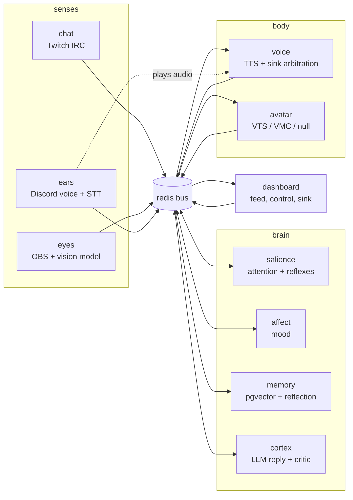

# High-Level Design: cohost

> Skeleton generated by `/map-codebase` on 2026-10-31 at git `686cc8f`.
> Sections marked *(not yet specified)* are intent the project owner has not
> authored yet. The System Design section describes what the code does today
> and is marked `[inferred]` where it states purpose rather than mechanism.

## Problem

*(not yet specified)*

## Approach

*(not yet specified)*

## Target Users

*(not yet specified)*

## Goals

*(not yet specified)*

## Non-Goals

*(not yet specified)*

## Tenets

*(not yet specified)*

## System Design

`[inferred]` cohost is a locally hosted AI VTuber co-host. Every component is a
separate Node process that talks only through typed events on a Redis Streams
bus (`cohost:events`, 19 event types) plus a separate `cohost:health` heartbeat stream. Senses publish what they observe; four brain regions
decide when and what to say; the body speaks and animates; an operator
dashboard watches and steers.

### Segments

| Taxonomy | Segment | Role (observed) |
| --- | --- | --- |
| platform | event-bus | Typed Redis Streams bus; 15 event types; consumer groups; test double |
| platform | config | YAML + env config schema and loader; personality / expressions files |
| platform | model-backends | Chat + embedding providers: Ollama, OpenAI-compatible, Claude API, Bedrock |
| platform | region-hooks | Pluggable judgement hooks: rules / llm / http with fallback to rules |
| platform | working-memory | Rolling window of recent events rendered as a prompt transcript |
| senses | chat | Twitch chat → `chat.message` |
| senses | eyes | OBS screenshot → vision model → `vision.summary` |
| senses | ears | Discord voice → Whisper → `speech.heard`; Discord playback sink |
| brain | salience | Scores events, decides when to speak, fires reflexes |
| brain | affect | Valence / arousal mood with decay → `affect.state` |
| brain | memory | Embeds and recalls exchanges; viewer table; reflection pass |
| brain | cortex | `attention.focus` → recall → LLM → critic → `brain.say` |
| body | voice | `brain.say` → TTS → `voice.utterance` + lip-sync envelope; sink arbitration |
| body | avatar | Canonical avatar state → VTube Studio / VMC driver |
| operator | dashboard | Live feed, mute / say, audio sink, personality editor, Services tab, test-input injection |
| operator | control-plane | Service manifest, start / stop / restart runtimes, heartbeat health tracker, `cohostctl` CLI |
| operator | deployment | Compose topology, single parameterized Dockerfile, installer, CI |

### Cross-cutting protocols (observed)

- **Turn-taking.** salience publishes `attention.focus`; cortex publishes
  `brain.status` (thinking / speaking / idle / muted) which salience uses as a
  busy flag; `voice.done` releases cortex. Reflexes bypass the LLM by
  publishing `brain.say` from salience directly.
- **Audio sink arbitration.** voice publishes `voice.utterance`; any sink
  (ears "discord", dashboard "dashboard") claims it with `voice.playing`; if no
  claim arrives within 1.5 s voice emits a virtual playing / done pair.
  avatar lip-syncs on `voice.playing` using the envelope from the utterance.
- **Region hooks.** salience.scorer, affect.appraiser, cortex.critic each run
  as rules / llm / http per config, falling back to rules on any failure.
- **Service health and control.** Every service publishes `service.heartbeat`
  to `cohost:health`; the control plane derives up / degraded / stale / down /
  crash-looping and the dashboard shows it. Start / stop / restart go through
  the control plane's manifest-gated runtimes and emit `service.lifecycle`.
- **Test injection and isolated backends.** `inject.request` / `inject.result`
  let the dashboard feed synthetic chat, screenshots, or audio into a sense;
  mock / stub / fake / off backends let any service run on Redis alone.
- **Transcript contract.** working-memory renders `[chat]` / `[voice]` /
  `[screen]` lines that model-backends uses as LLM stop strings.

## Key Design Decisions

*(not yet specified — per-segment inferred decisions live in each LLD's
Decisions & Alternatives table, marked `[inferred]` until confirmed)*

## Success Metrics

*(not yet specified)*

## References

- `docs/arrows/index.yaml` — segment index and dependency graph
- `docs/arrows/README.md` — how to navigate the overlay
- `README.md` — operator-facing documentation (quick start, configuration)
