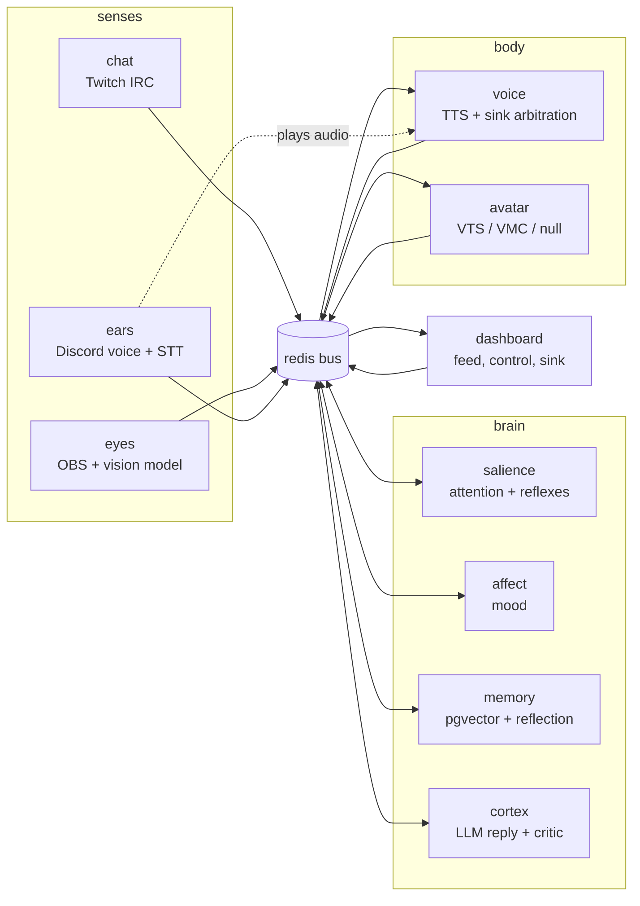

# High-Level Design: cohost

> Marker legend. `[proposed]` ends a sentence that states intent the project
> owner has not yet confirmed; it is a proposal drafted from the code, the
> README, the example config and personality files, and the commit history.
> `[inferred]` marks a statement of purpose read out of mechanism. A heading
> marked `[decision needed]` offers two or more intents that the code supports
> equally; the owner picks one and the others are deleted. Sentences with no
> marker are facts of the code at git `686cc8f`.

## Problem

A solo streamer has nobody to talk to. Chat scrolls past while the streamer is
mid-fight, voice chat is empty, and the stream has one voice and one face. A
second person in the room would watch the game, read chat, answer the people
who address them by name, remember who the regulars are and what the running
jokes were, and keep quiet the rest of the time. `[proposed]`

The hosted "AI VTuber" offerings that exist solve this by sending the whole
stream (chat, audio, frames) to a vendor, by running as one opaque process, or
both. That makes the co-host expensive per hour, impossible to run offline,
and impossible to take apart: the streamer cannot swap the chat model, keep
the memory local, train their own "is this worth a reaction" judgement, or
point the voice at a different avatar app without starting over. `[proposed]`

cohost is for a streamer who owns a GPU box and wants the co-host to live on
it: every sense, every brain region, the voice, the face and the memory run
locally in separate containers, and the only thing that may leave the machine
is the chat-model call, by explicit choice. `[proposed]`

## Approach

cohost is modelled as a creature with senses, a brain, and a body, with an
operator looking over its shoulder. Every part is its own process, and the
parts talk only through typed events on a Redis Streams bus. The metaphor is
deliberate: it gives each region one job, one set of inputs and one set of
outputs, and lets any part be replaced, mocked or run alone without the others
noticing. `[proposed]`

- **Senses** publish what they observe and consume nothing from the brain:
  `chat` turns Twitch IRC into `chat.message`, `eyes` turns an OBS screenshot
  into a one-line `vision.summary` from a local vision model, `ears` turns
  each Discord speaker's audio into `speech.heard` through local
  speech-to-text. Summaries and transcripts go on the bus, never frames or
  audio bytes.
- **The brain** is four regions, named for the parts of a brain they play.
  `salience` scores every unseen event and decides *when* to speak
  (`attention.focus`), and fires reflexes (canned `brain.say` lines with no
  model in the loop). `affect` keeps a valence/arousal mood that decays on
  its own (`affect.state`). `memory` is the only region that touches
  Postgres: it embeds what happened, answers `memory.recall.request`, knows
  the regulars, and between streams consolidates what it learned into the
  personality file. `cortex` is the only region that calls the chat model:
  it turns a focus plus personality, mood, viewer notes, recalled memories
  and the recent transcript into one spoken line, vetted by a critic hook.
- **The body** speaks and animates. `voice` synthesizes `brain.say` into
  audio, serves it over HTTP, computes a lip-sync envelope, and arbitrates
  which sink plays it. `avatar` turns bus events into a smooth canonical
  face state and hands it to a thin driver for VTube Studio, a VMC app, or
  nothing.
- **The operator** watches and steers through the `dashboard` (live feed,
  mute, say, personality editor, test-input injection, Services tab) and the
  control plane (heartbeats on a separate health stream, gated
  start/stop/restart from the dashboard or `cohostctl`).

Three cross-cutting choices make the metaphor hold up in practice. Judgement
that could use a model is a **hook** (`rules` / `llm` / `http`) that always
falls back to built-in rules, so the show goes on when a model is slow or
down. The chat model is behind one `ChatProvider` interface, so a stronger
brain is a `config.yaml` change and embeddings stay on local Ollama. And every
service has a mock, stub or off backend, so any one of them runs on Redis
alone with no account, GPU or API key. `[inferred]`

## Target Users

1. **The owner, streaming.** One person running cohost on their own Linux or
   WSL2 box with an NVIDIA GPU, OBS on the same or a second PC, a Twitch
   channel, a Discord voice channel, and a Live2D or VRM avatar app. They
   edit `.env`, `config.yaml` and `personality.md` by hand, run
   `docker compose up -d`, and watch the dashboard during the stream.
   `[proposed]`
2. **The owner, developing.** The same person between streams: running one
   service under `pnpm dev` against the rest in Compose, injecting test chat,
   screenshots and audio from the dashboard, reading the reflection pass's
   bullets and deleting the ones they do not like, and tuning talkativeness
   in YAML. `[proposed]`
3. **Another streamer with the same shape of setup.** The installer, the
   `*.example.*` seeding, the provider and hook recipes under `examples/`,
   the Pages docs site and the AGPL licence exist so a second person can
   clone, install and run without reading the source. `[proposed]`
4. **A tinkerer with their own model.** Someone who trains a scorer,
   appraiser or critic and serves it over HTTP, or swaps in a hosted chat
   model, without touching TypeScript. The `http` hook kind and the
   `examples/modules/server.py` stand-in are for them. `[proposed]`

Viewers are not users of the software. They experience the co-host through
Twitch chat, the stream audio and the avatar on screen; nothing in cohost is
for them to operate. `[proposed]`

## Goals

1. **Feel like a second person in the room, not an assistant.** Short spoken
   lines, names used when replying, opinions about the game, and silence
   when nothing is worth saying (`config/personality.example.md`).
   `[proposed]`
2. **Speak when it is worth it.** Mentions, questions, voice, and screen
   changes are scored against a threshold with a cooldown and a busy gate;
   reflexes react instantly to the things that should not wait for a
   thought. The co-host must never talk over itself, the streamer's clutch,
   or a line still playing. `[proposed]`
3. **Remember people and running jokes across streams.** Addressed chat,
   voice and the co-host's own lines are embedded and recalled; regulars are
   recognised by message count; the personality file grows a dated
   `## Learned` block after each stream that the owner can edit or delete.
   `[proposed]`
4. **Run locally on one GPU box.** Senses, brain, body, memory and the
   dashboard all run in Compose on the AI PC; only the cortex's chat call
   (and the reflection pass, which uses the same provider) may leave the
   machine, and only when the operator picks a hosted provider.
   `[proposed]`
5. **Swap any piece.** Adding a chat source, a TTS engine, an avatar driver,
   a model provider or a hook implementation never touches the brain
   regions; adding a region is a new service that subscribes and publishes.
   `[proposed]`
6. **Keep the stream going through failures.** A slow or absent model,
   memory region, voice sink or avatar app degrades one feature and is
   reported in the heartbeat; it never wedges the brain or crash-loops a
   container. `[proposed]`
7. **Be testable one piece at a time.** Every service runs on Redis alone
   with a mock/stub/off backend; the dashboard injects synthetic chat,
   images and audio into the real pipeline; pure logic is separated from
   I/O glue so it is unit-tested. `[proposed]`
8. **Let the operator see and steer during the stream.** One page shows the
   bus, brain status, mood, avatar preview and per-service health, and
   offers mute, say, forget, personality reload, and (when enabled) service
   restart. `[proposed]`

## Non-Goals

1. **Not a chat moderation or command bot.** Lines starting with `!` and
   messages from known bots are dropped at the sense; cohost never times
   out, bans, or answers commands. `[proposed]`
2. **Not a general assistant.** It does not look things up, run tools, or
   answer every message; the personality file says so explicitly.
   `[proposed]`
3. **Not a hosted or multi-tenant service.** One install serves one
   streamer; there is no account system, no tenancy, and the trust boundary
   is the operator's LAN plus an optional bearer token. `[proposed]`
4. **Not a player.** cohost watches the game through screenshots; it never
   sends input to the game or OBS. `[proposed]`
5. **Not a voice pipeline of its own.** Speaker segmentation is Discord's
   per-user streams plus silence detection; STT and TTS are off-the-shelf
   local servers. cohost adds no voice-activity detection, diarisation or
   echo cancellation. `[proposed]`
6. **Not a rendering engine.** The avatar is drawn by VTube Studio or a VMC
   app; cohost only drives parameters, expressions and gestures. The
   dashboard's SVG face is a preview, not a stream asset. `[proposed]`
7. **Not Windows-native.** The supported hosts are Ubuntu/Debian and WSL2;
   the installer targets those only. `[proposed]`
8. **Not a scripted character.** Beyond reflexes (regex to canned lines),
   dialogue is generated; there is no dialogue tree, intent classifier or
   scripted show. `[proposed]`

### Non-goal or deferred goal `[decision needed]`

- **Typing in chat.** The chat sense is read-only and nothing ever sends a
  line, yet `services/chat/src/index.ts:3-6` keeps optional credentials
  "needed later if you want the co-host to also *type* in chat".
  Alternative A: typing in chat is a non-goal; the co-host's only output is
  voice, and the credential path is removed. Alternative B: typing is a
  deferred goal, to be specified as a new body output beside `voice`.
- **Chat platforms beyond Twitch.** `chat.message.platform` admits
  `youtube` and `discord` (`packages/bus/src/events.ts:11`) and the README
  names a YouTube source as the canonical "add a sense" example, but only
  Twitch and the fake source exist. Alternative A: Twitch only is the goal;
  the enum is left for injection and future work. Alternative B:
  multi-platform chat is a goal and a YouTube sense is planned.
- **Idle chatter in a silent stream.** Salience only pipes up after
  `idle_chatter_ms` when at least one unseen event exists
  (`services/salience/src/scheduler.ts:47-48,71-73`); the README reads as
  unconditional. Alternative A: silence stays silent (the config comment
  "and there's fresh context"). Alternative B: the co-host should break a
  dead stream on its own.

## Tenets

Each tenet is a test a reviewer can apply to a design or a pull request.

1. **The bus is the only seam.** Services talk through typed events on
   `cohost:events` and nothing else. Reject a design in which two services
   call each other over HTTP, share a database, or import each other's
   runtime code. `[proposed]`
2. **Senses and body are swappable without touching the brain.** A new chat
   source, TTS engine, avatar driver, model provider or hook implementation
   changes config and one adapter file. Reject a change to a sense or body
   adapter that requires editing `salience`, `affect`, `memory` or `cortex`.
   `[proposed]`
3. **No model on the live path without a rules fallback and a timeout.** Any
   judgement that can call a model (scoring, appraisal, critic, recall) must
   have a built-in answer it falls back to, bounded by `timeout_ms`. Reject
   a feature whose failure mode is a silent or stuck co-host. `[proposed]`
4. **Speaking is gated.** Every `brain.say` either passed salience's
   threshold, cooldown and busy checks, matched a reflex that respects the
   same busy and cooldown gates, or was an explicit operator `say`. Reject a
   new path to `brain.say` that bypasses those gates. `[proposed]`
5. **A configuration gap degrades, never crashes.** A service missing a
   token, channel, device or app stays up, reports `degraded` or `off` in
   its heartbeat, and still accepts test injection. Reject a startup path
   that exits non-zero because an optional dependency is absent.
   `[proposed]`
6. **Every service runs on Redis alone.** Each backend a service talks to
   ships with a mock, stub or off mode selectable by one env preset and
   reported honestly as `mode: mock|off`. Reject a new backend without an
   isolated mode. `[proposed]`
7. **Behaviour in YAML, secrets in `.env`, persona in Markdown.** Reject a
   new setting that puts a secret in `config.yaml`, a behaviour knob in
   `.env` without a `${VAR:-default}` placeholder in YAML, or a persona
   fact anywhere but `personality.md`. `[proposed]`
8. **Local by default; only the chat-model call may leave the machine.**
   Audio, frames, chat text, embeddings and memories stay on the operator's
   box. Reject a default that sends any of them to a hosted service, and
   reject an embedding path that follows the chat provider off-machine.
   `[proposed]`

## System Design

`[inferred]` cohost is a locally hosted AI VTuber co-host. Every component is a
separate Node process that talks only through typed events on a Redis Streams
bus (`cohost:events`, 19 event types) plus a separate `cohost:health` heartbeat stream. Senses publish what they observe; four brain regions
decide when and what to say; the body speaks and animates; an operator
dashboard watches and steers.

### Segments

| Taxonomy | Segment | Role (observed) |
| --- | --- | --- |
| platform | event-bus | Typed Redis Streams bus; 19 event types; consumer groups; test double |
| platform | config | YAML + env config schema and loader; personality / expressions files |
| platform | model-backends | Chat + embedding providers: Ollama, OpenAI-compatible, Claude API, Bedrock |
| platform | region-hooks | Pluggable judgement hooks: rules / llm / http with fallback to rules |
| platform | working-memory | Rolling window of recent events rendered as a prompt transcript |
| senses | chat | Twitch chat → `chat.message` |
| senses | eyes | OBS screenshot → vision model → `vision.summary` |
| senses | ears | Discord voice → Whisper → `speech.heard`; Discord playback sink |
| brain | salience | Scores events, decides when to speak, fires reflexes |
| brain | affect | Valence / arousal mood with decay → `affect.state` |
| brain | memory | Embeds and recalls exchanges; viewer table; reflection pass |
| brain | cortex | `attention.focus` → recall → LLM → critic → `brain.say` |
| body | voice | `brain.say` → TTS → `voice.utterance` + lip-sync envelope; sink arbitration |
| body | avatar | Canonical avatar state → VTube Studio / VMC driver |
| operator | dashboard | Live feed, mute / say, audio sink, personality editor, Services tab, test-input injection |
| operator | control-plane | Service manifest, start / stop / restart runtimes, heartbeat health tracker, `cohostctl` CLI |
| operator | deployment | Compose topology, single parameterized Dockerfile, installer, CI |

### Cross-cutting protocols (observed)

- **Turn-taking.** salience publishes `attention.focus`; cortex publishes
  `brain.status` (thinking / speaking / idle / muted) which salience uses as a
  busy flag; `voice.done` releases cortex. Reflexes bypass the LLM by
  publishing `brain.say` from salience directly.
- **Audio sink arbitration.** voice publishes `voice.utterance`; any sink
  (ears "discord", dashboard "dashboard") claims it with `voice.playing`; if no
  claim arrives within 1.5 s voice emits a virtual playing / done pair.
  avatar lip-syncs on `voice.playing` using the envelope from the utterance.
- **Region hooks.** salience.scorer, affect.appraiser, cortex.critic each run
  as rules / llm / http per config, falling back to rules on any failure.
- **Service health and control.** Every service publishes `service.heartbeat`
  to `cohost:health`; the control plane derives up / degraded / stale / down /
  crash-looping and the dashboard shows it. Start / stop / restart go through
  the control plane's manifest-gated runtimes and emit `service.lifecycle`.
- **Test injection and isolated backends.** `inject.request` / `inject.result`
  let the dashboard feed synthetic chat, screenshots, or audio into a sense;
  mock / stub / fake / off backends let any service run on Redis alone.
- **Transcript contract.** working-memory renders `[chat]` / `[voice]` /
  `[screen]` lines that model-backends uses as LLM stop strings.

## Key Design Decisions

Project-level decisions, each with the design doc or file that embodies it.
Per-segment decisions live in each LLD's Decisions & Alternatives table and
stay `[inferred]` until confirmed; the rows here are the ones a fresh author
would need before reading any LLD.

| Decision | Chosen | Alternatives | Rationale | Embodied in |
| --- | --- | --- | --- | --- |
| Inter-service transport | Redis Streams with one consumer group per service and zod validation on both publish and read | HTTP between services; pub/sub; one monolith | A service can restart and resume, a poison event is logged and acked rather than wedging the stream, and every payload shape lives in one registry. `[proposed]` | [event-bus](intent/event-bus/event-bus-design.md); `packages/bus/src/events.ts:3-6` |
| Brain shape | Four regions (salience, affect, memory, cortex) as separate bus services | One brain process | Each region has one job and one set of inputs; regions can be paused, mocked, restarted and swapped independently, and only cortex ever calls the chat model. `[proposed]` | commit `969f6d7`; [salience](intent/salience/salience-design.md), [affect](intent/affect/affect-design.md), [memory](intent/memory/memory-design.md), [cortex](intent/cortex/cortex-design.md) |
| Who decides vs. who speaks | salience decides *when* (`attention.focus`), cortex decides *what* (`brain.say`), reflexes short-circuit both | cortex decides on its own; every event prompts the model | Talkativeness is a cheap, tunable scoring loop with no model in it; the expensive call only happens once something is worth a reply. `[proposed]` | [salience](intent/salience/salience-design.md) Scoring and Decision; [cortex](intent/cortex/cortex-design.md) think pipeline |
| Model backend | One `ChatProvider` interface over Ollama, OpenAI-compatible, Claude API, Bedrock and a mock; embeddings always local Ollama | Vendor code in each region; embeddings from the chat vendor | A stronger brain is a config change; the memory table's vector size never depends on which chat model is in use. `[inferred]` | [model-backends](intent/model-backends/model-backends-design.md); `packages/llm/src/index.ts:1-14` |
| Judgement hooks | `rules` / `llm` / `http` per hook, any failure falls back to rules | Built-in heuristics only; model-only | An operator can replace a region's judgement with a model, or a model they trained, without a code change, and a hook outage can never stop the show. `[inferred]` | [region-hooks](intent/region-hooks/region-hooks-design.md); `packages/modules/src/index.ts:14` |
| Turn-taking | `brain.status` as a busy flag, `voice.done` as the release, cooldown and `speaking_timeout_ms` as safety valves | Cortex queues focuses; voice drives the brain directly | The co-host never talks over itself; a missing sink or a crashed cortex releases the brain by timeout instead of freezing it. `[proposed]` | [salience](intent/salience/salience-design.md) Busy Gating; [cortex](intent/cortex/cortex-design.md) status machine |
| Where audio plays | voice synthesizes and serves WAV over HTTP; sinks (Discord bot, dashboard browser page) claim and play; a virtual sink times unclaimed lines | voice plays audio itself; audio bytes on the bus | The same line can land on stream through an OBS Browser Source and in the Discord channel with no virtual audio cables, and the brain moves on even when nobody is listening. `[inferred]` | [voice](intent/voice/voice-design.md) Sink Arbitration Protocol; [dashboard](intent/dashboard/dashboard-design.md) audio sink |
| Binary payloads | Never on the bus: events carry text, numbers, envelopes and URLs; audio and uploads travel over HTTP | Base64 on the stream | Keeps the 20 000-entry event stream small and replayable; sinks fetch what they need when they need it. `[inferred]` | `packages/bus/src/events.ts:126-137,166-170`; [voice](intent/voice/voice-design.md) Audio Store; [dashboard](intent/dashboard/dashboard-design.md) uploads |
| Avatar architecture | One `Engine` owns timing, smoothing, idle motion, blink and lip-sync; drivers translate canonical params to VTube Studio or VMC | Per-app animation logic | Adding an avatar app is one ~100-line driver plus an `expressions.yaml` block; the brain never knows which app is running. `[inferred]` | [avatar](intent/avatar/avatar-design.md); `services/avatar/src/engine.ts:6-9`, `types.ts:31-34` |
| Configuration split | Behaviour in `config.yaml` with `${VAR:-default}` placeholders, secrets and per-machine values in `.env`, persona in `personality.md`, emotion names in `expressions.yaml`; user files seeded from committed `*.example.*` | Env only; one JSON; baked config | The three user files are the operator's and git-ignored; a fresh clone runs from the examples; a backend can be flipped from `.env` without editing YAML. `[inferred]` | [config](intent/config/config-design.md); commit `969f6d7` ("Move provider and hook choices into config.yaml") |
| Persona and learning | Personality is a plain Markdown prompt; the reflection pass appends a dated `## Learned` block the owner edits by hand | Learned facts in the database only; a structured persona schema | The owner stays in control of who the co-host is with a text editor; nothing learned is hidden in a table. `[proposed]` | [memory](intent/memory/memory-design.md) Reflection pass; `config/personality.example.md` |
| Failure posture | Degrade and report, never exit: config gaps idle as `degraded`/`off`, model and store outages are waited for and reported, every backend has a mock/stub/off mode | Fail fast; supervisor restarts | Under Compose a crash loop hides the real cause; a heartbeat with a reason is actionable, and an isolated mode lets each piece be developed without accounts or a GPU. `[inferred]` | [chat](intent/chat/chat-design.md), [ears](intent/ears/ears-design.md), [eyes](intent/eyes/eyes-design.md) startup plans; [control-plane](intent/control-plane/control-plane-design.md) manifest presets |
| Health and control | Heartbeats on a separate capped stream; derived states computed by observers; control off by default, bearer-gated, manifest-only argv, loopback bind | Heartbeats on the event stream; always-on control | Liveness traffic never evicts domain events; a privileged endpoint has the smallest possible surface and is opt-in. `[inferred]` | [control-plane](intent/control-plane/control-plane-design.md); `packages/control/src/manifest.ts:1-5` |
| Deployment shape | One Dockerfile parameterised by `SERVICE`, infra ports on loopback, the dashboard as the only published port, optional senses behind Compose profiles | Per-service images; everything published | One build cached across ten images; OBS on another PC reaches only the dashboard; accounts and hardware are opted into per sense. `[inferred]` | [deployment](intent/deployment/deployment-design.md) |

### Trust boundary `[decision needed]`

The dashboard listens on all interfaces with no authentication unless
`CONTROL_ENABLED=1`, the `/ws` feed and `POST /sink` are never gated, the
voice HTTP server has CORS `*`, Postgres credentials are fixed, and containers
run as root ([dashboard](intent/dashboard/dashboard-design.md) Open Questions
6-8, [deployment](intent/deployment/deployment-design.md) Open Question 6).

- Alternative A: the trust boundary is the operator's LAN. Only the service
  lifecycle routes need a token because they can run commands; everything
  else is accepted as open, and hardening is a non-goal.
- Alternative B: a second streamer running this on a shared network is a
  target user, so read access to chat/voice transcripts and the ability to
  publish sink events need the same gate, and the posture becomes a goal.

## Success Metrics

The project has not yet been run against real Twitch, VTube Studio or Discord
(README "Status"); the first metric is therefore a milestone, the rest are
what to measure once it has. All targets are proposals. `[proposed]`

1. **First contact.** One full stream with real Twitch chat, a real Discord
   voice channel and a real avatar app, with every service `up` for the
   whole session and no `crash-looping` or `down` state in the Services tab.
   `[proposed]`
2. **Latency to speak.** Time from a chat mention landing on the bus to
   `voice.playing` from a real sink, measured on the owner's GPU box with the
   default local models. Target: under 4 s at the median. `[proposed]`
   `[decision needed]` the number is a guess; the owner sets it.
3. **Silence ratio.** Fraction of `chat.message` events that lead to a
   `brain.say`. The co-host should answer well under half of plain chat and
   nearly all direct mentions; a rising ratio over time means it is getting
   noisy. `[proposed]`
4. **Hook health.** Fallback warnings from `salience.scorer`,
   `affect.appraiser` and `cortex.critic` are rare in steady state (no more
   than one per 30 s window per hook, the current throttle). `[proposed]`
5. **Memory that sticks.** After the reflection pass, the share of
   `## Learned` bullets the owner keeps rather than deletes; recalled
   memories appear in the prompt for at least half of replies to regulars.
   `[proposed]`
6. **Time to first spoken line on a fresh box.** From `git clone` on a
   supported host to hearing a reply in the dashboard, editing only `.env`,
   in under 30 minutes excluding model downloads. `[proposed]`
7. **Isolation coverage.** Every one of the ten services starts and reports
   `ready` on Redis alone in CI; the Compose smoke test today covers four.
   `[proposed]`

## References

- `docs/arrows/index.yaml` — segment index and dependency graph
- `docs/arrows/README.md` — how to navigate the overlay
- `README.md` — operator-facing documentation (quick start, configuration)
- `config/personality.example.md`, `config/config.example.yaml` — the persona
  and behaviour knobs the goals above refer to
