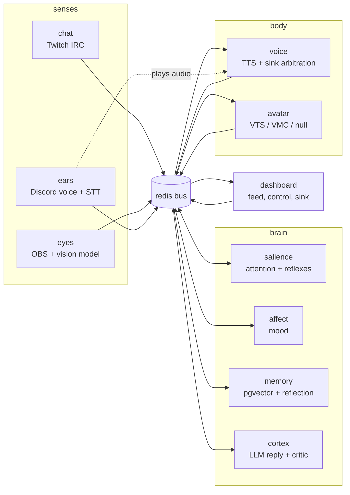

# High-Level Design: cohost

## Problem

A solo streamer has nobody to talk to. Chat scrolls past while the streamer is
mid-fight, voice chat is empty, and the stream has one voice and one face. A
second person in the room would watch the game, read chat, answer the people
who address them by name, remember who the regulars are and what the running
jokes were, and keep quiet the rest of the time.

The hosted "AI VTuber" offerings that exist solve this by sending the whole
stream (chat, audio, frames) to a vendor, by running as one opaque process, or
both. That makes the co-host expensive per hour, impossible to run offline,
and impossible to take apart: the streamer cannot swap the chat model, keep
the memory local, train their own "is this worth a reaction" judgement, or
point the voice at a different avatar app without starting over.

cohost is for a streamer who owns a GPU box and wants the co-host to live on
it: every sense, every brain region, the voice, the face and the memory run
locally in separate containers. All internal processing and storage stays on
the owner's LAN unless explicitly configured otherwise. Platform connections
(Twitch chat by default, YouTube, Discord) are intentional external
integrations. Chat-model and hook calls leave the LAN only
when explicitly configured. Audio, screenshots and synthesized text leave the
LAN only when the STT, Ollama or TTS URL points to a host outside it.
Generated audio leaves for Discord only when the Discord source is enabled.

## Approach

cohost is modelled as a creature with senses, a brain, and a body, with an
operator looking over its shoulder. Every part is its own process, and the
parts talk only through typed events on a Redis Streams bus. The metaphor is
deliberate: it gives each region one job, one set of inputs and one set of
outputs, and lets any part be replaced, mocked or run alone without the others
noticing.

- **Senses** publish what they observe and consume nothing from the brain
  on the sensing path (`ears` also consumes `voice.utterance` and reports
  Discord playback events as a sink for `voice`):
  `chat` turns Twitch IRC into `chat.message`, `eyes` turns an OBS screenshot
  into a one-line `vision.summary` from a local vision model, `ears` turns
  each Discord speaker's audio into `speech.heard` through local
  speech-to-text. Summaries and transcripts go on the bus, never frames or
  audio bytes.
- **The brain** is four regions, named for the parts of a brain they play.
  `salience` scores every unseen event and decides *when* to speak
  (`attention.focus`), and fires reflexes (canned `brain.say` lines with no
  model in the loop). `affect` keeps a valence/arousal mood that decays on
  its own (`affect.state`). `memory` is the only region that touches
  Postgres: it embeds what happened, answers `memory.recall.request`, knows
  the regulars, and between streams consolidates what it learned into the
  personality file. `cortex` is the only region that generates the main reply (salience and
  affect `llm` hooks and the cortex critic hook may also call a model):
  it turns a focus plus personality, mood, viewer notes, recalled memories
  and the recent transcript into one spoken line, vetted by a critic hook.
- **The body** speaks and animates. `voice` synthesizes `brain.say` into
  audio, serves it over HTTP, computes a lip-sync envelope, and arbitrates
  which sink plays it. `avatar` turns bus events into a smooth canonical
  face state and hands it to a thin driver for VTube Studio, a VMC app, or
  nothing.
- **The operator** watches and steers through the `dashboard` (live feed,
  mute, say, personality editor, test-input injection, Services tab) and the
  control plane (heartbeats on a separate health stream, gated
  start/stop/restart from the dashboard or `cohostctl`).

Three cross-cutting choices make the metaphor hold up in practice. Judgement
that could use a model is a **hook** (`rules` / `llm` / `http`) that always
falls back to built-in rules, so the show goes on when a model is slow or
down. The chat model is behind one `ChatProvider` interface, so a stronger
brain is a `config.yaml` change, while embeddings are chosen separately by
`brain.memory.embedder` (local Ollama by default, a deterministic hash embedder
offline) and never follow the chat provider. And every
service has a mock, stub or off backend, so any one of them runs on Redis
alone with no account, GPU or API key.

## Target Users

cohost is built for one streamer: the owner, on their own stream.

1. **The owner, streaming.** One person running cohost on their own Linux or
   WSL2 box with an NVIDIA GPU, OBS on the same or a second PC, a Twitch
   channel, a Discord voice channel, and a Live2D or VRM avatar app. They
   edit `.env`, `config.yaml` and `personality.md` by hand, run
   `docker compose up -d`, and watch the dashboard during the stream.
2. **The owner, developing.** The same person between streams: running one
   service under `pnpm dev` against the rest in Compose, injecting test chat,
   screenshots and audio from the dashboard, reading the reflection pass's
   bullets and deleting the ones they do not like, and tuning talkativeness
   in YAML.
3. **The owner, tinkering with their own model.** Training a scorer,
   appraiser or critic and serving it over HTTP, or swapping in a hosted chat
   model, without touching TypeScript. The `http` hook kind and the
   `examples/modules/server.py` stand-in are for this.

Other streamers are not a target user. The installer, the `*.example.*`
seeding, the recipes under `examples/`, the Pages docs site and the AGPL
licence stay, and a defect in any of them is a bug that gets fixed with the
same weight as a code defect, because the owner reinstalls and rereads them
too. Hardening for other people's setups (shared networks, several
streamers, untrusted operators) is not a goal.

Viewers are not users of the software. They experience the co-host through
Twitch chat, the stream audio and the avatar on screen; nothing in cohost is
for them to operate.

## Goals

1. **Feel like a second person in the room, not an assistant.** Short spoken
   lines, names used when replying, opinions about the game, and silence
   when nothing is worth saying (`config/personality.example.md`). This
   voice, a second person in the room for whom silence is fine, is the
   project's voice, not only the example persona.
2. **Speak when it is worth it.** Mentions, questions, voice, and screen
   changes are scored against a threshold with a cooldown and a busy gate;
   reflexes react instantly to the things that should not wait for a
   thought. The co-host must never talk over itself or a line still playing.
3. **Remember people and running jokes across streams.** Addressed chat,
   voice and the co-host's own lines are embedded and recalled; regulars are
   recognised by message count; the personality file grows a dated
   `## Learned` block after each stream that the owner can edit or delete.
4. **Run locally on one GPU box.** Senses, brain, body, memory and the
   dashboard all run in Compose on the AI PC; the LAN is the trust boundary
   for internal processing and storage (platform connections such as Twitch
   chat are intentional external integrations);
   chat-model, reflection and hook calls leave the LAN only when explicitly
   configured; audio, screenshots and synthesized text leave only when the
   STT, Ollama or TTS URL points outside it; generated audio reaches Discord
   only when the Discord source is enabled.
5. **Swap any piece.** Adding a chat source, a TTS engine, an avatar driver,
   a model provider or a hook implementation never touches the brain
   regions; adding a region is a new service that subscribes and publishes.
6. **Keep the stream going through failures.** A slow or absent model,
   memory region, voice sink or avatar app degrades one feature and is
   reported in the heartbeat; it never wedges the brain or crash-loops a
   container.
7. **Be testable one piece at a time.** Every service runs on Redis alone
   with a mock/stub/off backend; the dashboard injects synthetic chat,
   images and audio into the real pipeline; pure logic is separated from
   I/O glue so it is unit-tested.
8. **Let the operator see and steer during the stream.** One page shows the
   bus, brain status, mood, avatar preview and per-service health, and
   offers mute, say, forget, personality reload, and (when enabled) service
   restart.
9. **Hear chat from more than one platform.** `chat.message.platform` admits
   `twitch`, `youtube` and `discord`, and a new chat source is a new sense
   that publishes `chat.message` without touching the brain. Twitch is the
   only platform implemented today.

### Deferred goals

These are goals, not non-goals, but no work is scheduled for them yet; the
code keeps the seams they need.

- **Staying quiet through the streamer's clutch moments.** The co-host does
  not detect a high-stakes moment in the game today, so it can speak over
  one. A future goal is to hold lines while the streamer is mid-clutch.
- **Typing in chat.** The chat sense is read-only today. A future body output
  beside `voice` will post the co-host's lines to chat; the optional Twitch
  user credentials in `services/chat/src/index.ts:4-6` stay for it.
- **Breaking a dead stream's silence.** Idle chatter fires only after
  `idle_chatter_ms` of quiet *and* at least one unseen event
  (`services/salience/src/scheduler.ts:48,72-73`); a fully silent stream
  stays silent. Unprompted talk on a stream with nothing new to react to is a
  future goal.

## Non-Goals

1. **Not a chat moderation or command bot.** Lines starting with `!` and
   messages from known bots are dropped at the sense; cohost never times
   out, bans, or answers commands.
2. **Not a general assistant.** It does not look things up, run tools, or
   answer every message; the personality file says so explicitly.
3. **Not a hosted, multi-tenant or hardened service.** One install serves one
   streamer; there is no account system and no tenancy. The trust boundary is
   the operator's LAN (see Trust boundary below); hardening against other
   hosts on that LAN is not a goal.
4. **Not a player.** cohost watches the game through screenshots; it never
   sends input to the game or OBS.
5. **Not a voice pipeline of its own.** Speaker segmentation is Discord's
   per-user streams plus silence detection; STT and TTS are off-the-shelf
   local servers. cohost adds no voice-activity detection, diarisation or
   echo cancellation.
6. **Not a rendering engine.** The avatar is drawn by VTube Studio or a VMC
   app; cohost only drives parameters, expressions and gestures. The
   dashboard's SVG face is a preview, not a stream asset.
7. **Not Windows-native.** The supported hosts are Ubuntu/Debian and WSL2;
   the installer targets those only.
8. **Not a scripted character.** Beyond reflexes (regex to canned lines),
   dialogue is generated; there is no dialogue tree, intent classifier or
   scripted show.

## Tenets

Each tenet is a test a reviewer can apply to a design or a pull request.

1. **The bus is the only seam.** Services exchange control and events as
   typed events on `cohost:events`; HTTP is allowed only for binary or object
   transfer (such as voice audio), operator APIs, and configured `http` hooks
   that POST JSON to `module.url`. Reject a design in which two services
   call each other over HTTP, share a database, or import each other's
   runtime code.
2. **Senses and body are swappable without touching the brain.** A new chat
   source, TTS engine, avatar driver, model provider or hook implementation
   changes config and one adapter file. Reject a change to a sense or body
   adapter that requires editing `salience`, `affect`, `memory` or `cortex`.
3. **No model on the live path without a rules fallback and a timeout.** Any
   judgement that can call a model (scoring, appraisal, critic, recall) must
   have a built-in answer it falls back to, bounded by `timeout_ms`. Reject
   a feature whose failure mode is a silent or stuck co-host.
4. **Speaking is gated.** Every `brain.say` either passed salience's
   threshold, cooldown and busy checks, matched a reflex that respects the
   same busy and cooldown gates, or was an explicit operator `say`. Reject a
   new path to `brain.say` that bypasses those gates.
5. **A configuration gap degrades, never crashes.** A service missing a
   token, channel, device or app stays up, reports `degraded` or `off` in
   its heartbeat, and still accepts test injection. Reject a startup path
   that exits non-zero because an optional dependency is absent.
6. **Every service runs on Redis alone.** Each backend a service talks to
   ships with a mock, stub or off mode selectable by one env preset and
   reported honestly as `mode: mock|off`. Reject a new backend without an
   isolated mode.
7. **Behaviour in YAML, secrets in `.env`, persona in Markdown.** Reject a
   new setting that puts a secret in `config.yaml`, a behaviour knob in
   `.env` without a `${VAR:-default}` placeholder in YAML, or a persona
   fact anywhere but `personality.md`.
8. **Local by default; only explicitly configured egress may leave the LAN.**
   Internal processing and storage stay on the LAN; platform connections
   (Twitch chat, YouTube, Discord) are intentional external integrations, not
   egress in this sense. Egress means chat-model and hook calls, a remote STT,
   Ollama, TTS, Redis (`REDIS_URL`) or Postgres (`DATABASE_URL`) URL outside the
   LAN, and Discord audio when the Discord source is enabled.
   Audio, frames, chat text, embeddings and memories stay on the operator's
   LAN unless that egress is configured. Reject a default that sends any of
   them to a hosted service, and reject an embedding path that follows the
   chat provider off the LAN.

## System Design

cohost is a locally hosted AI VTuber co-host. Every component is a
separate Node process that talks only through typed events on a Redis Streams
bus (`cohost:events`, 18 event types) plus a separate `cohost:health` heartbeat stream (19 registered payloads in all). Senses publish what they observe; four brain regions
decide when and what to say; the body speaks and animates; an operator
dashboard watches and steers.

### Segments

| Taxonomy | Segment | Role (observed) |
| --- | --- | --- |
| platform | event-bus | Typed Redis Streams bus; 18 event types plus 1 health type; consumer groups; test double |
| platform | config | YAML + env config schema and loader; personality / expressions files |
| platform | model-backends | Chat + embedding providers: Ollama, OpenAI-compatible, Claude API, Bedrock |
| platform | region-hooks | Pluggable judgement hooks: rules / llm / http with fallback to rules |
| platform | working-memory | Rolling window of recent events rendered as a prompt transcript |
| senses | chat | Twitch chat → `chat.message` |
| senses | eyes | OBS screenshot → vision model → `vision.summary` |
| senses | ears | Discord voice → Whisper → `speech.heard`; Discord playback sink |
| brain | salience | Scores events, decides when to speak, fires reflexes |
| brain | affect | Valence / arousal mood with decay → `affect.state` |
| brain | memory | Embeds and recalls exchanges; viewer table; reflection pass |
| brain | cortex | `attention.focus` → recall → LLM → critic → `brain.say` |
| body | voice | `brain.say` → TTS → `voice.utterance` + lip-sync envelope; sink arbitration |
| body | avatar | Canonical avatar state → VTube Studio / VMC driver |
| operator | dashboard | Live feed, mute / say, audio sink, personality editor, Services tab, test-input injection |
| operator | control-plane | Service manifest, start / stop / restart runtimes, heartbeat health tracker, `cohostctl` CLI |
| operator | deployment | Compose topology, single parameterized Dockerfile, installer, CI |

### Cross-cutting protocols (observed)

- **Turn-taking.** salience publishes `attention.focus`; cortex publishes
  `brain.status` (thinking / speaking / idle / muted) which salience uses as a
  busy flag; `voice.done` releases cortex. Reflexes bypass the LLM by
  publishing `brain.say` from salience directly. Mute and pause are seen only
  by the regions that decide to speak: salience and cortex honour `mute` and
  `pause` (affect also honours `pause` for its own appraisal), and a mute or
  pause that lands while a decision is in flight stops that decision. voice
  and ears never read `control`: they speak and play every `brain.say` they
  receive, so muting upstream is the only mute. An operator `say` is the one
  override: cortex speaks it even while muted, paused or busy.
- **Audio sink arbitration.** voice publishes `voice.utterance`; any sink
  (ears "discord", dashboard "dashboard") claims it with `voice.playing`; if no
  claim arrives within 1.5 s voice emits a virtual playing / done pair, and a
  real claim that arrives after the window cancels the pending virtual
  `voice.done` so cortex is not released while audio still plays.
  avatar lip-syncs on `voice.playing` using the envelope from the utterance.
  Sinks inside Compose fetch audio from `http://voice:8700`; a player on the
  host or another PC goes through the dashboard's audio proxy, since voice's
  port is not published.
- **Region hooks.** salience.scorer, affect.appraiser, cortex.critic each run
  as rules / llm / http per config, falling back to rules on any failure.
- **Service health and control.** Every service publishes `service.heartbeat`
  to `cohost:health`; the control plane derives up / degraded / stale / down /
  crash-looping and the dashboard shows it. Start / stop / restart go through
  the control plane's manifest-gated runtimes and emit `service.lifecycle`.
- **Test injection and isolated backends.** `inject.request` / `inject.result`
  let the dashboard feed synthetic chat, screenshots, or audio into a sense;
  mock / stub / fake / off backends let any service run on Redis alone.
- **Transcript contract.** working-memory owns the `[chat]` / `[voice]` /
  `[screen]` transcript tags; model-backends mirrors them as LLM stop strings.
  The stops save tokens rather than guard correctness (cortex keeps only the
  first line of a reply), the co-host's own line is not a stop, and a
  cortex-level test checks the rendered tags against the stop list.
- **Restart start position.** Every subscription names a start mode:
  `latest` resets the service's consumer group to the newest entry on every
  start, `resume` keeps the group's stored position. memory uses `resume`;
  every other subscriber uses `latest`. Delivery across a restart is
  at-most-once.

## Key Design Decisions

Project-level decisions, each with the design doc or file that embodies it.
Per-segment decisions live in each LLD's Decisions & Alternatives table; the
rows here are the ones a fresh author would need before reading any LLD.

| Decision | Chosen | Alternatives | Rationale | Embodied in |
| --- | --- | --- | --- | --- |
| Inter-service transport | Redis Streams with one or more consumer groups per service and zod validation on both publish and read | HTTP between services; pub/sub; one monolith | A service can restart and pick its start position, a poison event (unknown type, non-JSON data, failed schema) is dropped and acked without logging rather than wedging the stream, and every payload shape lives in one registry. | [event-bus](intent/event-bus/event-bus-design.md); `packages/bus/src/events.ts:5-8` |
| Brain shape | Four regions (salience, affect, memory, cortex) as separate bus services | One brain process | Each region has one job and one set of inputs; regions can be paused, mocked, restarted and swapped independently, and cortex or an explicitly configured `llm` hook can call a chat model. | commit `969f6d7`; [salience](intent/salience/salience-design.md), [affect](intent/affect/affect-design.md), [memory](intent/memory/memory-design.md), [cortex](intent/cortex/cortex-design.md) |
| Who decides vs. who speaks | salience decides *when* (`attention.focus`), cortex decides *what* (`brain.say`), reflexes short-circuit both | cortex decides on its own; every event prompts the model | Talkativeness is a cheap, tunable scoring loop with no model in it; the expensive call only happens once something is worth a reply. | [salience](intent/salience/salience-design.md) Scoring and Decision; [cortex](intent/cortex/cortex-design.md) think pipeline |
| Model backend | One `ChatProvider` interface over Ollama, OpenAI-compatible, Claude API, Bedrock and a mock; embeddings are selected by `brain.memory.embedder` (local Ollama, or a deterministic hash embedder offline), independently of `llm.provider` | Vendor code in each region; embeddings from the chat vendor | A stronger brain is a config change; the memory table's vector size never depends on which chat model is in use. | [model-backends](intent/model-backends/model-backends-design.md); `packages/llm/src/index.ts:1-14` |
| Judgement hooks | `rules` / `llm` / `http` per hook, any failure falls back to rules | Built-in heuristics only; model-only | An operator can replace a region's judgement with a model, or a model they trained, without a code change, and a hook outage can never stop the show. | [region-hooks](intent/region-hooks/region-hooks-design.md); `packages/modules/src/index.ts:14` |
| Turn-taking | `brain.status` as a busy flag, `voice.done` as the release, cooldown and `speaking_timeout_ms` as safety valves | Cortex queues focuses; voice drives the brain directly | The co-host never talks over itself; a missing sink or a crashed cortex releases the brain by timeout instead of freezing it. | [salience](intent/salience/salience-design.md) Busy Gating; [cortex](intent/cortex/cortex-design.md) status machine |
| Who honours mute and pause | Only salience and cortex (and affect, for `pause` of its own appraisal); voice and ears never read `control`; an operator `say` bypasses mute, pause and busy | Every service mutes itself; voice drops lines while muted | One place decides whether the co-host may speak, so a mute cannot be half-applied across services; the body stays a dumb output that plays what it is given; the operator always has a way to speak. Owner decision 2026-11-01. | [salience](intent/salience/salience-design.md), [cortex](intent/cortex/cortex-design.md); [voice](intent/voice/voice-design.md), [ears](intent/ears/ears-design.md) |
| Start position after a restart | An explicit subscribe start mode: `latest` resets the consumer group to `$` on every start, `resume` keeps the stored position; memory uses `resume`, every other subscriber uses `latest`; delivery across restarts is at-most-once (a crashed instance's unacknowledged entries are not redelivered) | Resume everywhere (replay the backlog after downtime); at-least-once with stable consumer names and `XAUTOCLAIM` | A co-host that comes back after a crash must not answer minutes-old chat, speak queued lines or replay old focuses; memory is the one region that wants the backlog, because storing what was said while it was down costs nothing on stream. Owner decision 2026-11-01. | [event-bus](intent/event-bus/event-bus-design.md); [memory](intent/memory/memory-design.md) |
| Where audio plays | voice synthesizes and serves WAV over HTTP; sinks (Discord bot, dashboard browser page) claim and play; a virtual sink times unclaimed lines | voice plays audio itself; audio bytes on the bus | The same line can land on stream through an OBS Browser Source and in the Discord channel with no virtual audio cables, and the brain moves on even when nobody is listening. | [voice](intent/voice/voice-design.md) Sink Arbitration Protocol; [dashboard](intent/dashboard/dashboard-design.md) audio sink |
| Binary payloads | Never on the bus: events carry text, numbers, envelopes and URLs; audio and uploads travel over HTTP | Base64 on the stream | Keeps the 20 000-entry event stream small and replayable; sinks fetch what they need when they need it. | `packages/bus/src/events.ts:137-151,188-204`; [voice](intent/voice/voice-design.md) Audio Store; [dashboard](intent/dashboard/dashboard-design.md) uploads |
| Avatar architecture | One `Engine` owns timing, smoothing, idle motion, blink and lip-sync; drivers translate canonical params to VTube Studio or VMC | Per-app animation logic | Adding an avatar app is one ~100-line driver plus an `expressions.yaml` block; the brain never knows which app is running. | [avatar](intent/avatar/avatar-design.md); `services/avatar/src/engine.ts:6-9`, `types.ts:31-34` |
| Configuration split | Behaviour in `config.yaml` with `${VAR:-default}` placeholders, secrets and per-machine values in `.env`, persona in `personality.md`, emotion names in `expressions.yaml`; user files seeded from committed `*.example.*` | Env only; one JSON; baked config | The three user files are the operator's and git-ignored; a fresh clone runs from the examples; a backend can be flipped from `.env` without editing YAML. | [config](intent/config/config-design.md); commit `969f6d7` ("Move provider and hook choices into config.yaml") |
| Persona and learning | Personality is a plain Markdown prompt; the reflection pass appends a dated `## Learned` block the owner edits by hand | Learned facts in the database only; a structured persona schema | The owner stays in control of who the co-host is with a text editor; nothing learned is hidden in a table. | [memory](intent/memory/memory-design.md) Reflection pass; `config/personality.example.md` |
| Failure posture | Degrade and report, never exit: config gaps idle as `degraded`/`off`, model and store outages are waited for and reported, every backend has a mock/stub/off mode; a failed bus publish is logged and the service continues, and a failed subscription or tail read retries with backoff inside the bus. Two cases still exit non-zero: a config value that is present but invalid (for example an unknown `AVATAR_DRIVER`) fails the config load, and the dashboard exits when Redis is unreachable at start | Fail fast; supervisor restarts | Under Compose a crash loop hides the real cause; a heartbeat with a reason is actionable, and an isolated mode lets each piece be developed without accounts or a GPU. An invalid value is an operator mistake to fix, not a gap to idle through, and without Redis there is no bus to report on. The publish, retry and exit cases are owner decisions of 2026-11-01. | [chat](intent/chat/chat-design.md), [ears](intent/ears/ears-design.md), [eyes](intent/eyes/eyes-design.md) startup plans; [control-plane](intent/control-plane/control-plane-design.md) manifest presets |
| Health and control | Heartbeats on a separate capped stream; derived states computed by observers; control off by default, bearer-gated, manifest-only argv, loopback bind | Heartbeats on the event stream; always-on control | Liveness traffic never evicts domain events; a privileged endpoint has the smallest possible surface and is opt-in. | [control-plane](intent/control-plane/control-plane-design.md); `packages/control/src/manifest.ts:1-5` |
| Trust boundary | The operator's LAN is the boundary. Control mode (`CONTROL_ENABLED=1`) puts a bearer token on mutations only (lifecycle routes and other state-changing posts); reads (`/ws`, `GET /personality`, `GET /services`) stay open; `POST /sink` stays ungated; host-side audio sinks use the dashboard proxy | Gate reads and sink events with the same token; per-user accounts | cohost serves the owner's own stream on their own network. An OBS Browser Source cannot answer an auth prompt, so gating `/sink` would break the main audio path. The open reads do expose more than the stream shows: `GET /personality` returns the whole personality file including its `## Learned` notes, and `/ws` carries every domain event (unaddressed chat, recall replies, viewer notes, vision summaries); the operator keeps the dashboard port off untrusted networks. Fixed Postgres credentials, voice CORS `*` and root containers are accepted inside this boundary. Owner decision 2026-11-01. | [dashboard](intent/dashboard/dashboard-design.md); [deployment](intent/deployment/deployment-design.md); [control-plane](intent/control-plane/control-plane-design.md) |
| Deployment shape | One Dockerfile parameterised by `SERVICE`, infra ports on loopback, the dashboard as the only published port, optional senses behind Compose profiles | Per-service images; everything published | One build cached across ten images; OBS on another PC reaches only the dashboard; accounts and hardware are opted into per sense. | [deployment](intent/deployment/deployment-design.md) |

### Trust boundary

The trust boundary is the operator's LAN. With service control off (the
default; Compose pins it off for the containerised dashboard,
DEPLOY-COMPOSE-016) the dashboard listens on all interfaces. With `CONTROL_ENABLED=1` every mutating
route needs the bearer token, and the dashboard binds `127.0.0.1` unless
`CONTROL_BIND` names another address (it warns when that address is not
loopback), so a Browser Source on another PC needs `CONTROL_BIND` set; the
`/ws` feed, the `GET` routes and `POST /sink` stay open in both modes. The
open reads expose more than the stream shows: `GET /personality` returns the
whole personality file including its `## Learned` notes, and `/ws` carries
every domain event, including unaddressed chat, recall replies and viewer
notes. The operator therefore keeps the dashboard port off networks they do
not trust. The sink stays ungated because an OBS Browser Source cannot authenticate, and a
host-side audio player reaches voice only through the dashboard's audio proxy,
since Compose does not publish voice's port. Inside this boundary the voice
HTTP server's CORS `*`, the fixed Postgres credentials and root containers are
accepted; hardening against other hosts on the LAN is a non-goal.

## Success Metrics

The project has not yet been run against real Twitch, VTube Studio or Discord
(README "Status"); the first metric is therefore a milestone, the rest are
what to measure once it has. All targets are proposals.

1. **First contact.** One full stream with real Twitch chat, a real Discord
   voice channel and a real avatar app, with every service `up` for the
   whole session and no `crash-looping` or `down` state in the Services tab.
2. **Latency to speak.** Time from a chat mention landing on the bus to
   `voice.playing` from a real sink, measured as the median on the owner's GPU
   box with the default local models. The target is "as fast as possible":
   there is no pass/fail threshold; the measured median is tracked from stream
   to stream and should trend down.
3. **Silence ratio (heuristic).** Fraction of distinct `chat.message` events
   that receive an attributable `brain.say` within 60 s, so the ratio cannot
   exceed 1; reflexes and voice-, vision- or operator-triggered lines are
   excluded. `brain.say` carries no source-message id, so
   attribution is window-based: a message counts as answered when an
   `attention.focus` whose `focus` has that message's `who` and `text` is
   followed by a cortex `brain.say` within the 60 s window. Matching is not
   unique: identical `who` and `text` inside the window count once, as
   answered by at most one `brain.say`. A stable source-message id on
   `attention.focus` and `brain.say` is a possible future change that would
   make attribution exact. The
   co-host should answer well under half of plain chat and nearly all direct
   mentions; a rising ratio over time means it is getting noisy.
4. **Hook health.** Fallback rate (fallbacks per hook call, counted per
   occurrence rather than from the logger, which throttles to one warning per
   30 s) for `salience.scorer`, `affect.appraiser` and `cortex.critic` is
   under 5% of that hook's calls in any hour of steady-state streaming.
5. **Memory that sticks.** After the reflection pass, the share of
   `## Learned` bullets the owner keeps rather than deletes; recalled
   memories appear in the prompt for at least half of replies to regulars.
6. **Time to first spoken line on a fresh box.** From `git clone` on a
   supported host to hearing a reply in the dashboard, editing only `.env`,
   in under 30 minutes excluding model downloads.
7. **Isolation coverage.** Every one of the ten services starts and reports
   `ready` on Redis alone in CI; the Compose smoke test today covers four.

## References

- `docs/arrows/index.yaml` — segment index and dependency graph
- `docs/arrows/README.md` — how to navigate the overlay
- `README.md` — operator-facing documentation (quick start, configuration)
- `config/personality.example.md`, `config/config.example.yaml` — the persona
  and behaviour knobs the goals above refer to
