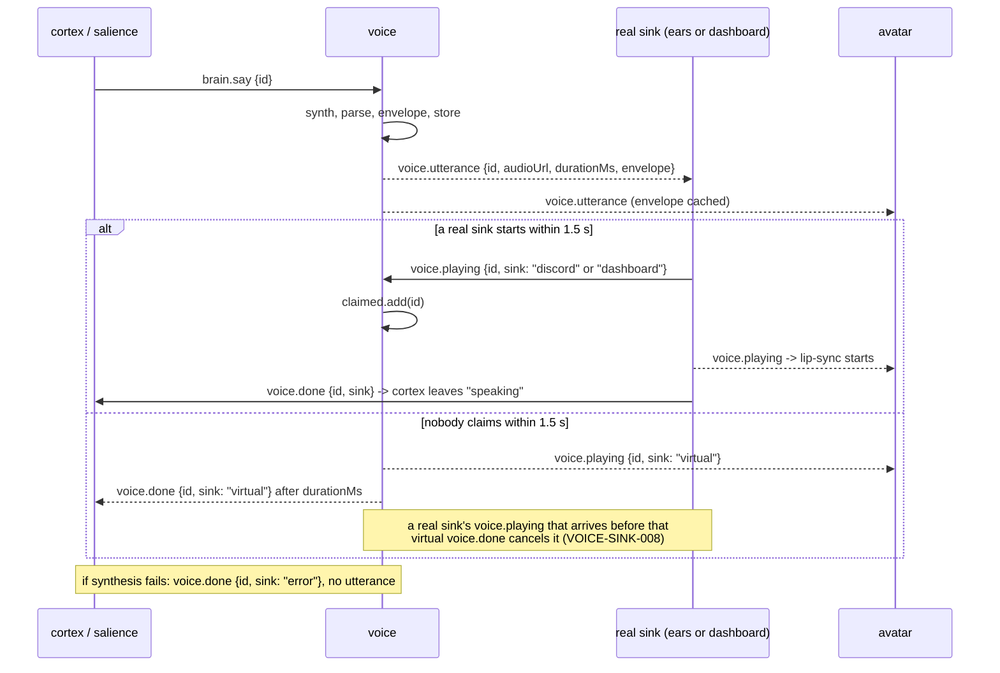

# voice

> Mapped 2026-10-31 at git `686cc8f`; audited 2026-11-02 at git `1b57790`. Describes the intended design; where the code does not yet match, the text names the gap and its spec ID. A rationale cell cites the code comment, commit, design note or owner decision (2026-11-01) that states the reason; where no such source exists, the cell gives the engineering reason the design rests on. HLD: [high-level-design](../../high-level-design.md).

## Context and Design Philosophy

voice turns the brain's `brain.say` into audio and is the **owner of the audio-sink arbitration protocol** that decides who plays that audio and when the brain may move on. It is one Node process (`services/voice`) with three jobs, as its header comment lays out (`services/voice/src/index.ts:1-9`):

1. **Synthesize.** Call a TTS server (Kokoro-FastAPI, OpenAI-compatible) or, with `voice.engine: stub`, fabricate a silent WAV of plausible length.
2. **Describe and serve.** Parse the WAV, compute a 30 Hz mouth-open envelope for lip-sync, keep the WAV in a bounded in-memory store, publish `voice.utterance`, and serve the bytes over HTTP on `:8700` so any sink can fetch them.
3. **Arbitrate sinks.** Voice does not play audio itself. Sinks ([ears](../ears/ears-design.md) as `discord`, [dashboard](../dashboard/dashboard-design.md) as `dashboard`) claim an utterance by publishing `voice.playing`; if nobody does within 1.5 s voice pretends to be a sink (`virtual`) so the brain never waits forever; if synthesis fails voice releases the brain with a `voice.done` from sink `error`.

Design leanings visible in the code:

- **Keep the brain moving.** Every failure path ends in a `voice.done` (error sink, virtual sink) so [cortex](../cortex/cortex-design.md) is never left in `speaking` (`voice.ts:149-153`, `voice.ts:144-148`). The comments say so directly: "a virtual sink times it so the brain moves on" (`index.ts:7-8`) and "Let the brain continue even though nothing was said" (`voice.ts:151`).
- **Binary audio never rides the bus.** The bus carries a URL, a duration, and a small envelope; the WAV is fetched over HTTP (`packages/bus/src/events.ts:126-137`). Stream entries stay small, so every consumer and the dashboard's backfill read only metadata, and a sink fetches the bytes only when it plays them.
- **Effects injected, logic testable.** `Voice` takes `bus`, `log`, `synth`, `publicUrl` (`voice.ts:8-15`); synthesizers are plain functions; tests drive `Voice.onEvent` and `Voice.handle` directly with a `FakeBus` and mocked timers, so the arbitration protocol is tested without Redis, a TTS server or real time.
- **A stub engine is a first-class mode** so the whole bus path can run with no TTS container (commit `51d5a9c`, "mock/off backends so any service runs on Redis alone").

Ownership notes (from the mapping brief): `src/health.ts` implements the heartbeat contract owned by [control-plane](../control-plane/control-plane-design.md); the voice `stub` backend belongs here; the `voice.*` event schemas live in [event-bus](../event-bus/event-bus-design.md).

## Synthesis Pipeline

Boot (`runVoice`, `boot.ts:26-50`; `index.ts` only supplies the real `setup`): inside one `try`, load config, create `Bus("voice")`, read `VOICE_PORT` (default `8700`) and `urls.voice()`, build `VoiceHealth(cfg.voice.engine)`, start the heartbeat, pick the synthesizer, create `Voice`, listen on the port, position the consumer group with `bus.resetGroup("voice")`, call `heartbeat.ready()`, and start one bus loop:

`bus.subscribe({ group: "voice", types: ["brain.say", "voice.playing"], start: "latest" }, ev => voice.onEvent(ev))` (`boot.ts:45`).

Readiness means "can receive `brain.say`": `ready` is reported only once the HTTP server listens **and** the `voice` group exists at the stream's newest entry. The bus has no "subscribed" notification (`subscribe` resolves only when the bus stops), so boot creates and positions the group itself with `resetGroup` before `ready`, and `subscribe` then runs the same positioning (`latest` resets again); a `brain.say` published in the few milliseconds between the two is dropped, which is what `latest` allows. Everything runs inside the `try`, so a config error, a port in use, an unreachable Redis at the group call or a rejecting subscription all log `fatal` and exit 1 (VOICE-SYN-006).

That single loop handles events strictly one at a time (`packages/bus/src/index.ts:157-167` awaits the handler per entry). While a `brain.say` is being synthesized, a following `voice.playing` claim waits behind it.

**Start mode.** voice subscribes with the event-bus `latest` start mode: the `voice` group is moved to the newest stream entry on every start, so a `brain.say` published while voice was down is never spoken (VOICE-SYN-001). Delivery across a restart is therefore at-most-once, which suits a live co-host: a stale line spoken late is worse than a line dropped. This holds for every restart path, including a compose `restart: unless-stopped` restart (`docker-compose.yml:10`); the control plane's `fresh` start (voice's manifest default, `packages/control/src/manifest.ts:45`) is no longer the only thing that skips the backlog.

The bus retries a failed subscription read with backoff (event-bus); a subscription rejection that still reaches voice is logged with message `fatal` and ends the process with a non-zero status, so compose restarts it with a clear cause (VOICE-SYN-006). A Redis outage does not reject it (the subscriber connection uses `maxRetriesPerRequest: null`, so its commands wait for the reconnect); another Redis error, such as the group being deleted, does.

`onSay` (`voice.ts:126-154`), per `brain.say { id, text, emotion, gesture, ... }`:

1. `wav = await synth(text)`.
2. `info = parseWav(wav)`; `env = envelope(wav, info, 30)`.
3. `put(id, wav)` into the store, **before** announcing it.
4. Publish `voice.utterance { id, text, emotion, gesture, durationMs: round(info.durationMs), envelopeHz: 30, envelope, audioUrl: <PUBLIC>/audio/<id>.wav, sampleRate }`.
5. Arm the 1.5 s virtual-sink timer (see Sink Arbitration).
6. Any exception in 1-5 is caught: log `"tts failed"`, publish `voice.done { id, sink: "error" }` (`voice.ts:149-153`). That covers TTS HTTP errors, a non-WAV reply, a non-16-bit WAV (envelope throws), and a failed publish. No `voice.utterance` is emitted in that case (unless the failure was the timer-arming step, which cannot throw).

The timer callbacks run outside that `try`. Their publishes go through `publishVirtual` (`voice.ts:91-97`), which logs a failure at warn (`virtual sink publish failed`) and returns, so voice keeps running (VOICE-SINK-009); the publishing connection gives up after three reconnect attempts (`maxRetriesPerRequest: 3`, `packages/bus/src/index.ts:44`), so a virtual-sink timer that fires during a Redis outage would otherwise end the process.

Voice speaks **everything** on `brain.say` regardless of `injected` / `remember` flags or `reason`, and it never subscribes to `control` (VOICE-SYN-005). Mute and pause are seen only by the regions that decide to speak, [cortex](../cortex/cortex-design.md) and [salience](../salience/salience-design.md); an operator `say` reaches voice as an ordinary `brain.say` and is spoken even while the co-host is muted.

### Engines

| `voice.engine` | Synthesizer | Network | Heartbeat |
| --- | --- | --- | --- |
| `kokoro` (default) | `kokoroSynth`: `POST <TTS_URL>/v1/audio/speech` with JSON `{ model: "kokoro", input: text, voice: cfg.voice, speed: cfg.speed, response_format: "wav" }`; non-2xx throws `tts <status>: <body>` (`voice.ts:18-34`) | yes (`urls.tts()`, default `http://127.0.0.1:8880`) | mode `live`, `deps.kokoro` follows the last synthesis (`health.ts:7-19`) |
| `stub` | `stubSynth`: zero-filled mono PCM16 WAV at `voice.sample_rate`, duration `max(400, 60 * text.length)` ms (`voice.ts:36-62`) | none | mode `mock`, `deps.kokoro: n/a`; startup logs a warning (`boot.ts:32`) |

`voice.engine` comes from `VOICE_ENGINE` via `config/config.example.yaml:128` (an empty value falls back to `kokoro`, `packages/config/src/schema.ts:161`); `voice.voice` (default `af_heart`), `voice.speed` (schema default 1, example YAML 1.05), `voice.sample_rate` (24000, **used only by the stub**; Kokoro's rate comes from the WAV it returns) are in `packages/config/src/schema.ts:159-165`. The stub's shape follows the isolated-backends design: a silent PCM16 mono WAV sized from the text "so `parseWav`/`envelope` and `voice.utterance` fields stay real" (`openspec/changes/archive/2026-11-01-add-isolated-backends/design.md`, D5).

### WAV parsing and the lip-sync envelope

`parseWav` (from `@cohost/shared`, `packages/shared/src/wav.ts`; ears uses the same parser through `readWavHeader`, see [ears](../ears/ears-design.md)): requires `RIFF`...`WAVE`; walks chunks (odd sizes padded), reads channels / sample rate / bits from `fmt `, and on `data` clamps the length to the buffer (tolerates truncated or streamed replies) and computes `durationMs = frames / sampleRate * 1000`. Throws `not a RIFF/WAVE file` or `no data chunk`. It does not check the format tag (PCM vs float) and a missing `fmt ` leaves zeros (divide by zero).

`envelope` (`wav.ts:8-26`): 16-bit only (throws `unsupported bit depth N`); reads **only the first channel**; one window per `floor(sampleRate / hz)` frames (800 at 24 kHz / 30 Hz) including a partial last window; per window `min(1, (rms / 0.22) ^ 0.8)`; then a one-pole release `out[i] = max(out[i], out[i-1] * 0.6)` so the mouth closes over several windows; rounded to 2 decimals. `ENVELOPE_HZ = 30` is a constant (`voice.ts:6`). [avatar](../avatar/avatar-design.md) consumes the envelope from `voice.utterance` and indexes it from `voice.playing`.

## Audio Store and HTTP

The store (`voice.ts:66-85`) is a `Map<id, Buffer>` plus an insertion-order array; `put` evicts from the front while more than 50 ids are held. Eviction is by count only, not size or age, and the same id published twice is stored twice in `order` (the second `put` overwrites the buffer but both order entries later delete the one key). Evicting an id also drops its real-sink claim (VOICE-SINK-007).

`Voice.handle` (`voice.ts:157-169`), mounted on a plain `http.createServer` listening on all interfaces:

| Request | Response |
| --- | --- |
| `GET /audio/<id>.wav` where `id` matches `[\w-]+` and is stored | `200`, `content-type: audio/wav`, `content-length`, `access-control-allow-origin: *`, WAV body |
| same path, id unknown or evicted | `404` body `gone` |
| `GET /health` | `200` body `ok` (no check of Redis or TTS) |
| anything else | `404`, empty body |

Method is not checked (any method on those paths behaves like GET), and the match is on the raw request URL, so a query string turns a valid path into a 404. `/health` is a liveness ping only: container health comes from heartbeat freshness, and voice keeps `/health` alongside it (`openspec/changes/archive/2026-11-01-add-service-health/design.md`, D5). `urls.voice()` (`packages/config/src/index.ts:173`) is the base used in `audioUrl`: `VOICE_URL`, else `http://127.0.0.1:<VOICE_PORT>`, a loopback default chosen so host runs work outside Docker (commit `e53badc`, "default VOICE_URL to loopback outside Docker"); compose sets `VOICE_URL=http://voice:8700` for every TS service (`docker-compose.yml:18`). Compose does **not publish** port 8700 to the host (`docker-compose.yml:129-134`); in-network sinks (ears) fetch directly and browsers reach audio through the dashboard's `/audio/*` proxy (`services/dashboard/src/routes.ts:58-62`). That proxy is the only supported path for a player outside the compose network: a host-side sink is not a supported topology, so port 8700 stays unpublished and the loopback `urls.voice()` default serves only host runs of voice itself.

## Sink Arbitration Protocol

Voice owns this protocol; [ears](../ears/ears-design.md) and [dashboard](../dashboard/dashboard-design.md) are sinks that follow it, [cortex](../cortex/cortex-design.md) and [avatar](../avatar/avatar-design.md) consume its outcome. It is entirely carried by three events in `packages/bus/src/events.ts`:

| Event | Payload | Meaning |
| --- | --- | --- |
| `voice.utterance` | `{ id, text, emotion, gesture?, durationMs, envelopeHz, envelope, audioUrl, sampleRate }` | Audio for `id` exists at `audioUrl`; any sink may fetch and play it (`events.ts:126-137`) |
| `voice.playing` | `{ id, sink: string }` | The named sink started playing `id` (`events.ts:140`) |
| `voice.done` | `{ id, sink: string }` | The named sink finished (or gave up on) `id` (`events.ts:141`) |

`sink` is a free-form string. Values in use: `"discord"` (ears), `"dashboard"` (dashboard browser page), `"virtual"` (voice's fallback), `"error"` (voice, synthesis failed).

### Sequence

### Rules

1. **Claiming.** On every `voice.playing` that voice reads, if `sink !== "virtual"` and the id's audio is still stored, the id is added to the `claimed` set (`voice.ts:118-119`). The virtual sink's own `voice.playing` therefore claims nothing. That exclusion has no observable effect unless an id is re-used, because voice publishes its virtual `voice.playing` only after the claim check has already passed. A claim lives as long as the audio: `put` drops it when it evicts the id (`voice.ts:83`), so the set never exceeds the store's 50 ids (VOICE-SINK-007).
2. **Virtual fallback.** Right after publishing `voice.utterance`, voice arms `setTimeout(1500)`. When it fires and the id is not in `claimed`, voice publishes `voice.playing { id, sink: "virtual" }`, waits for that publish to resolve (or fail, which is logged), and then, if the id is still not claimed, arms `setTimeout(info.durationMs)` to publish `voice.done { id, sink: "virtual" }` (`Voice.playVirtual`, `voice.ts`). The done is timed from the resolved playing publish, so a slow publish never puts the two back-to-back and avatar keeps its lip-sync interval; a real sink that claims the id during that publish prevents the done from being armed at all. If the id is claimed, voice does nothing further for it (VOICE-SINK-004).
3. **Late claim.** A real sink's `voice.playing` that arrives after the virtual `voice.playing` but before the virtual `voice.done` cancels that pending `voice.done`, so the real sink's own `voice.done` is the one that releases cortex (VOICE-SINK-008). The pending done timers are kept per id (`virtualDone`, `voice.ts:73`) and cleared by the late claim (`voice.ts:120-122`). The fix stays inside voice; sinks keep their duties unchanged. A claim that arrives after the virtual `voice.done` was published changes nothing.
4. **Error release.** On any synthesis-path failure voice publishes only `voice.done { id, sink: "error" }` (`voice.ts:152`). No virtual timers run.
5. **Sinks' duties.** A sink should publish `voice.playing` when audio actually starts and `voice.done` when it ends. Dashboard: on the `<audio>` element's `play` / `ended` / `error`, via `POST /sink` which the dashboard turns into `voice.playing` / `voice.done` with `sink: "dashboard"` (`services/dashboard/public/index.html:145-146`, `services/dashboard/src/routes.ts:120-122`). ears: `Playback` as described in the [ears LLD](../ears/ears-design.md). Both receive `voice.utterance` over the bus (dashboard through its tail).
6. **Who is released by `voice.done`.** cortex clears `speakingId` on the first `voice.done` for its own id from **any** sink (`services/cortex/src/cortex.ts:56-60`), with `brain.cortex.speaking_timeout_ms` (20 s) as a backstop (`cortex.ts:169`, `packages/config/src/schema.ts:153-154`). avatar starts lip-sync on `voice.playing` and ends it on `voice.done` for the matching id (`services/avatar/src/boot.ts`, `voice.playing` and `voice.done` cases).
7. **Voice never reads `voice.done`.** It does not subscribe to it and keeps no per-id lifecycle; completion tracking is entirely the consumers'.

### Known limits of the protocol

- **Slow or queued real sinks look like absent sinks at first.** The claim window is a fixed 1.5 s measured from `voice.utterance`, but a sink may legitimately start later: ears queues utterances behind the one playing and then does a fetch, convert and play before publishing `voice.playing` (`services/ears/src/playback.ts:39-46`); a second line queued behind a long first line is always timed by the virtual sink. With the late-claim rule (VOICE-SINK-008) the virtual `voice.done` is cancelled, so cortex waits for the real sink; the id still sees two `voice.playing` events (virtual, then real), and [avatar](../avatar/avatar-design.md) restarts lip-sync from the first envelope value on the second one (`services/avatar/src/engine.ts:39-45`).
- **No exclusivity.** If both ears and a dashboard sink are active they both claim, both play, and both publish `voice.playing` and `voice.done` for the same id; voice only uses claims to suppress its own fallback, never to pick one sink. The same line playing on two sinks is accepted (see Decisions): cortex is released by whichever `voice.done` arrives first, and avatar lip-syncs from the first `voice.playing` it sees (a second one restarts the envelope). Running two sinks is the operator's choice.
- **Claim ordering.** Claims are read by the same sequential loop that runs TTS. A claim for utterance A can be queued behind the synthesis of utterance B, so the 1.5 s timer for A may fire before the claim is processed and publish a spurious virtual `voice.playing`. When the queued claim is then processed, the late-claim rule cancels the pending virtual `voice.done` (VOICE-SINK-008); only if the claim is still queued when A's `durationMs` has elapsed does a virtual `voice.done` release cortex early. (Loop semantics at `packages/bus/src/index.ts:194-222`; timer at `voice.ts:145`.)
- **Timers outlive shutdown.** The 1.5 s timer is not tracked or cleared; shutdown closes the server and stops the bus (`boot.ts:37`).
- **A silent dashboard sink is still "a sink".** The dashboard page queues every `voice.utterance` even while audio is disabled and only plays when enabled (`index.html:137,142,331`); because it publishes `voice.playing` only on actual playback, a disabled page falls through to the virtual sink correctly, but a later enable replays the stale backlog.

## Health

`VoiceHealth` (`health.ts:7-19`): `service: "voice"`; `kokoro` engine gives mode `live` and `deps.kokoro` `ok` initially, `down` after any failed synthesis, `ok` again after the next success (the synthesizer is wrapped with `tracked`, `boot.ts:33`); `stub` gives mode `mock` and `kokoro: "n/a"`. `heartbeat.ready()` is called once the HTTP server is listening and the `voice` consumer group has been positioned (`boot.ts:42`), so `ready` means voice can receive `brain.say`. `startHeartbeat` (owned by [control-plane](../control-plane/control-plane-design.md)) reports `degraded` while a dep is `down`. Shutdown closes the HTTP server and stops the bus after the pre-shutdown `stopping` heartbeat (`boot.ts:37`, `packages/bus/src/index.ts:231-257`).

## Decisions & Alternatives

| Decision | Chosen | Alternatives Considered | Rationale |
| --- | --- | --- | --- |
| Where audio plays | Voice synthesizes and serves; separate sinks play | Voice plays locally; push audio over the bus | Header comment: voice keeps the WAV and serves it "so any 'sink' (dashboard audio page captured by OBS, the Discord bot) can fetch and play it" (`index.ts:4-7`). |
| How audio reaches sinks | HTTP GET of a stored WAV by URL | Base64 on the stream | Events carry only `audioUrl`; schema comment "Path on the voice service" (`events.ts:134`). A few seconds of 24 kHz PCM16 is hundreds of kilobytes; base64 on the stream would bloat every entry that every consumer, the dashboard tail and its backfill read, while only a playing sink needs the bytes. |
| Brain release when nobody plays | Virtual sink timed by `durationMs` after 1.5 s | Wait for a sink indefinitely; timeout in cortex only | Header comment: "if no sink picks an utterance up, a virtual sink times it so the brain moves on" (`index.ts:7-8`). The 1.5 s window trades a longer wait for the brain when no sink is present (latency is to be as low as possible) against spurious virtual pairs for a sink that starts slowly, which the late-claim rule (VOICE-SINK-008) absorbs. It is a fixed starting value, not measured against a real Discord sink, and is expected to be retuned on first contact. Waiting indefinitely would stall the brain whenever no sink runs; cortex's own 20 s backstop is a last resort, far slower than the virtual sink. |
| Claim mechanism | Any non-`virtual` `voice.playing` for the id suppresses the fallback | Explicit sink registration; sink ack protocol | Reuses the `voice.playing` every sink already publishes for avatar lip-sync (`voice.ts:119`), so no new event, registration step or sink state exists; a sink needs no knowledge of the fallback. Registration or an ack protocol would add events and per-sink lifecycle for no behaviour the claim does not already give. |
| TTS failure | Publish `voice.done` sink `error`, no utterance | Retry; emit a silent utterance | Comment: "Let the brain continue even though nothing was said" (`voice.ts:151`). |
| Audio store | In-memory map, newest 50 | Disk, TTL | Sinks fetch an utterance as soon as they play it, so audio is needed for seconds, not across restarts; 50 ids bound memory while covering any realistic sink queue (`voice.ts:80`). Disk adds I/O and cleanup for data no one reads after playback; a TTL bounds by age rather than memory. |
| Envelope shape | 30 Hz RMS, soft knee `(rms/0.22)^0.8`, 0.6 release | Peak, FFT/visemes | Comments: the soft knee makes "normal speech read as ~0.3-0.8 mouth-open rather than hugging zero" and the release is "light smoothing so the mouth doesn't flicker" (`wav.ts:4-7,24`). RMS tracks loudness more steadily than peak, which jumps on single samples; FFT or viseme analysis would cost more and needs a mouth model with more than the one open value avatar drives. |
| Envelope source channel | First channel only | Mix channels | Kokoro returns mono (`wav.ts:1`, `wav.test.ts:81`), so the first channel is the whole signal; mixing would add work for no TTS output in use. |
| WAV support | 16-bit PCM only | Floats / other depths | Comment: "PCM 16-bit only (what Kokoro emits)" (`wav.ts:1`). |
| Stub engine | Silent WAV sized 60 ms/char (min 400 ms) | Skip voice.utterance entirely | Isolated-backends design D5: silence sized from the text "so `parseWav`/`envelope` and `voice.utterance` fields stay real" (`openspec/changes/archive/2026-11-01-add-isolated-backends/design.md`; commit `51d5a9c`). |
| `audioUrl` base default | `VOICE_URL`, else loopback `http://127.0.0.1:<VOICE_PORT>` | `http://voice:<VOICE_PORT>` | Commit `e53badc`: "default VOICE_URL to loopback outside Docker"; compose already sets `VOICE_URL=http://voice:8700`. |
| Subscription | One sequential loop; event-bus start mode `latest` (group moved to the newest entry on every start; at-most-once across restarts) | Resume the backlog (`resume`); leave the reset to the control plane's `fresh` start only | Owner decision 2026-11-01: stale `brain.say` lines are never spoken after any restart, including a compose restart; the start mode is decided once in event-bus. The single sequential loop is the event-bus `subscribe` contract (one handler at a time, in stream order); it keeps voice's state free of concurrency, at the cost of claims waiting behind a synthesis (see Known limits and Open Question 1). |
| Late real sink | A real sink's `voice.playing` after the virtual one cancels the pending virtual `voice.done` (VOICE-SINK-008) | Widen the claim window to cover sink queues; have sinks drop lines voice already timed; a protocol-wide single-lifecycle rule enforced by sinks | Owner decision 2026-11-01: a voice-only change; cortex is released by the sink that is actually playing, and avatar keeps following every `voice.playing`. |
| Sink exclusivity | None: two active sinks both play and both report | Exclusive first claim; sink priority | Owner decision 2026-11-01: accepted. Claims only suppress the virtual fallback; running Discord and an OBS dashboard sink together is the operator's choice. |
| Mute awareness | voice is unaware of mute and pause; it speaks every `brain.say` | voice subscribes to `control` and drops lines while muted | Owner decision 2026-11-01: mute and pause are seen only by cortex and salience, which decide whether to speak; an operator `say` bypasses mute and must still be heard. |
| Host-side sinks | Not supported except through the dashboard's `/audio/*` proxy; compose does not publish 8700 | Publish 8700 to the host; CORS-open host access | Owner decision 2026-11-01: the LAN is the trust boundary and the dashboard is the one published port; browser and OBS sinks already go through the proxy. |
| Bus failures | Virtual-sink publish failures are logged and voice continues; a subscription rejection that survives the bus's retry is logged `fatal` and exits non-zero | Crash on any failure; ignore silently | Owner decision 2026-11-01 (cross-cutting): a failed publish never ends a service; a dead subscription is a clear, restartable failure. |
| Readiness | `ready` after the HTTP server listens and the `voice` group is positioned with `resetGroup`, before the subscription loop starts | `ready` when the server listens (before the bus is usable); a "subscribed" hook in event-bus | Owner decision 2026-11-01 (R3): ready means "can receive `brain.say`". The bus has no hook that fires when `subscribe` has created the group and `subscribe` resolves only at stop, so boot positions the group itself; a hook would remove the duplicate positioning but needs an event-bus change. |
| Serving | Plain `node:http`, CORS `*` | Express | Two routes need no framework, so voice adds no dependency; CORS `*` lets a browser sink fetch cross-origin (`voice.ts:162`), and compose publishes voice's port to no host (browsers reach audio through the dashboard proxy). |

## Open Questions & Future Decisions

1. **Single sequential loop does TTS and claim intake.** A slow synthesis delays claim processing and can cause spurious virtual pairs; synthesis could be moved off the loop (as cortex does by not awaiting `this.think(...)`, `cortex.ts:67`).
2. **Two WAV writers.** `stubSynth` hand-builds a header (`voice.ts:41-62`) beside ears' `wavWrap` (`services/ears/src/audio.ts`). The parser is shared (`@cohost/shared`); the writers are not.
3. **Cross-service test import.** `services/voice/test/voice.test.ts:5` imports `../../ears/src/audio.js` (only for `wavWrap`, the one WAV writer not yet shared), coupling voice's test run to ears' source; `services/voice/tsconfig.json` has `include: ["src"]`, so tests are not type-checked by `tsc -b` and only run through tsx (root `package.json:19`).
4. **`parseWav` robustness.** No check of the `fmt ` format tag or that `fmt ` precedes `data`; a missing `fmt ` chunk (zero bits or channels) yields a non-finite duration (`packages/shared/src/wav.ts`). Envelope silently ignores extra channels.
5. **HTTP method and query strings.** `Voice.handle` does not check the method, and it matches the raw URL, so `/audio/<id>.wav?x` or `/health?x` returns 404 (`voice.ts:158,166`).
6. **Id reuse.** Re-synthesizing an existing id appends a second entry to `order` (`voice.ts:77-85`), so one eviction can remove an id that is still the newest.
7. **Config defaults diverge.** `voice.speed` schema default is 1 (`schema.ts:163`) but `config/config.example.yaml:130` ships 1.05; the frozen OpenSpec says default 1.
8. **Tests missing.** `services/voice/test/boot.test.ts` covers boot wiring, but no test covers real signal handling or process exit (`onShutdown` and `process.exit` are injected). The 1.5 s timer is not cleared on shutdown.

## References

Files in this segment:

- `services/voice/src/index.ts`, `boot.ts`, `voice.ts`, `wav.ts`, `health.ts`
- `services/voice/test/boot.test.ts`, `health.test.ts`, `stub.test.ts`, `voice.test.ts`, `wav.test.ts`
- `services/voice/package.json`, `services/voice/tsconfig.json`
- `packages/shared/src/wav.ts`, `packages/shared/test/wav.test.ts` (`parseWav`, shared with ears; VOICE-ENV-001, VOICE-ENV-002)

Other segments (arrow shows direction):

- voice -> [event-bus](../event-bus/event-bus-design.md): consumes `brain.say`, `voice.playing` (group `voice`, moved to the newest entry on every start); publishes `voice.utterance`, `voice.playing` (virtual), `voice.done` (virtual / error), heartbeats.
- voice -> [config](../config/config-design.md): `loadConfig` (`voice.*`), `urls.tts()`, `urls.voice()`, `envOr("VOICE_PORT")`.
- voice <- [cortex](../cortex/cortex-design.md) and [salience](../salience/salience-design.md): publish `brain.say`; cortex consumes `voice.done`.
- voice <-> [ears](../ears/ears-design.md): ears is the `discord` sink and fetches `audioUrl`.
- voice <-> [dashboard](../dashboard/dashboard-design.md): dashboard is the `dashboard` sink and proxies `GET /audio/*` to voice.
- voice -> [avatar](../avatar/avatar-design.md): `voice.utterance` envelope + `voice.playing` / `voice.done` drive lip-sync.
- voice -> [control-plane](../control-plane/control-plane-design.md): heartbeat contract; manifest entry sets `VOICE_ENGINE=stub` for isolated starts (`packages/control/src/manifest.ts:44`).
- voice -> [deployment](../deployment/deployment-design.md): compose service `voice` depends on `tts` and does not publish its port.

External: Kokoro-FastAPI (OpenAI-compatible `POST /v1/audio/speech`), Node `http`.

OpenSpec: `openspec/specs/voice/spec.md`; deltas `openspec/changes/archive/2026-11-01-add-service-health/specs/voice/spec.md`, `openspec/changes/archive/2026-11-01-add-isolated-backends/specs/voice/spec.md`.

EARS specs: [voice-specs.md](./voice-specs.md).
