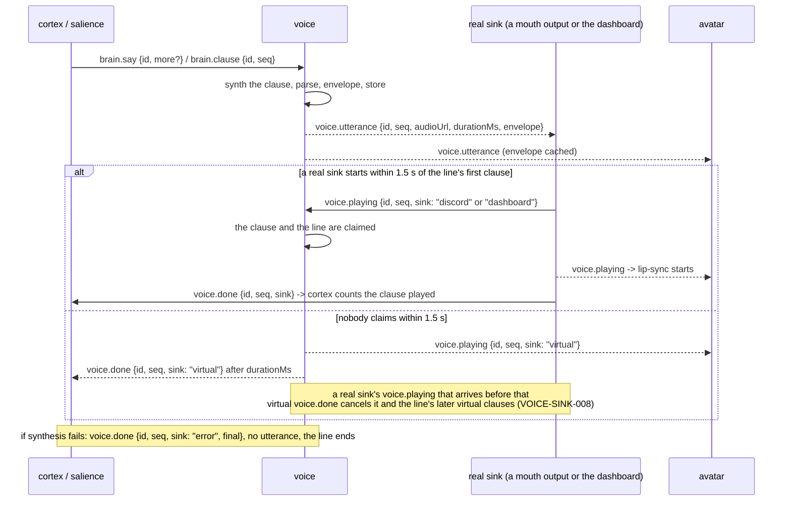

# voice

> Mapped 2026-10-31 at git `686cc8f`; audited 2026-11-02 at git `1b57790`. Describes the intended design. A rationale cell cites the code comment, commit, design note or owner decision (2026-11-01) that states the reason; where no such source exists, the cell gives the engineering reason the design rests on. HLD: [high-level-design](../../high-level-design.md).

## Context and Design Philosophy

voice turns the brain's `brain.say` into audio and is the **owner of the audio-sink arbitration protocol** that decides who plays that audio and when the brain may move on. It is one Node process (`services/voice`) with three jobs, as its header comment lays out (`services/voice/src/index.ts`):

1. **Synthesize.** Ask the configured TTS engine for the audio of each clause of a line (a reply is spoken clause by clause, [Lines and clauses](#lines-and-clauses)): Kokoro-FastAPI (the default), any server that speaks the OpenAI speech route, Kyutai Pocket TTS, or, with `voice.engine: stub`, a silent WAV of plausible length. Every engine sits behind one contract ([The TTS engine contract](#the-tts-engine-contract)).
2. **Describe and serve.** Parse each clause's WAV, compute a 30 Hz mouth-open envelope for lip-sync, keep the WAV in a bounded in-memory store, publish `voice.utterance`, and serve the bytes over HTTP on `:8700` so any sink can fetch them.
3. **Arbitrate sinks.** Voice does not play audio itself. Sinks (each [mouth](../mouth/mouth-design.md) output under its own name, today `discord`; the [dashboard](../dashboard/dashboard-design.md) page as `dashboard`) claim a line by publishing `voice.playing` for one of its clauses; if nobody does within 1.5 s voice pretends to be a sink (`virtual`) so the brain never waits forever; if synthesis fails voice releases the brain with a `voice.done` from sink `error`.

Design leanings visible in the code:

- **Keep the brain moving.** Every failure path ends in a `voice.done` (error sink, virtual sink) so [cortex](../cortex/cortex-design.md) is never left in `speaking` (`Voice.onClause`, `Voice.playVirtual`). The comments say so directly: "a virtual sink times it so the brain moves on" (`index.ts`) and "Let the brain continue even though nothing was said" (`voice.ts`).
- **Binary audio never rides the bus.** The bus carries a URL, a duration, and a small envelope; the WAV is fetched over HTTP (`packages/bus/src/events.ts`). Stream entries stay small, so every consumer and the dashboard's backfill read only metadata, and a sink fetches the bytes only when it plays them.
- **Effects injected, logic testable.** `Voice` takes `bus`, `log`, `engine`, `publicUrl`; an engine is an object behind the one contract, so a test hands in a fake; tests drive `Voice.onEvent` and `Voice.handle` directly with a `FakeBus` and mocked timers, so the arbitration protocol is tested without Redis, a TTS server or real time.
- **A stub engine is a first-class mode** so the whole bus path can run with no TTS container (commit `51d5a9c`, "mock/off backends so any service runs on Redis alone").

Ownership notes (from the mapping brief): `src/health.ts` implements the heartbeat contract owned by [control-plane](../control-plane/control-plane-design.md); the voice `stub` backend belongs here; the `voice.*` event schemas live in [event-bus](../event-bus/event-bus-design.md).

## Synthesis Pipeline

Boot (`runVoice` in `boot.ts`; `index.ts` only calls it) runs through the shared `runService` bootstrap (shared-runtime SHARED-BOOT-*), which loads config, creates `Bus("voice")` and starts the heartbeat in `starting` with the `VoiceHealth` spec. Voice's `main` then reads `VOICE_PORT` (default `8700`) and `urls.voice()`, builds the engine `voice.engine` names, creates `Voice`, registers its teardown, listens on the port, positions the consumer group with `bus.resetGroup("voice")`, calls `heartbeat.ready()`, and starts one bus loop:

`bus.subscribe({ group: "voice", types: ["brain.say", "brain.clause", "voice.playing", "voice.failed", "voice.stop"], start: "latest" }, ev => voice.onEvent(ev))`.

Readiness means "can receive `brain.say`": `ready` is reported only once the HTTP server listens **and** the `voice` group exists at the stream's newest entry. The bus has no "subscribed" notification (`subscribe` resolves only when the bus stops), so boot creates and positions the group itself with `resetGroup` before `ready`, and `subscribe` then runs the same positioning (`latest` resets again); a `brain.say` published in the few milliseconds between the two is dropped, which is what `latest` allows. Everything runs inside the `try`, so a port in use, an unreachable Redis at the group call or a rejecting subscription logs `fatal` and exits 1 (VOICE-SYN-006); a configuration that does not load is reported by the shared bootstrap, which logs the loader's message and exits 1 (SHARED-BOOT-002). The group call waits for the bus's first connect attempt, at most 10 s (BUS-NAT-CONN-006), so a Redis that is still starting does not fail it, while one that refuses connections fails it at once.

The loop reads events one at a time, in stream order (the event-bus `subscribe` contract). It never waits for synthesis: a `brain.say` or `brain.clause` goes onto an internal queue and the handler returns at once, so a `voice.playing` or `voice.failed` that follows is read and applied while a clause is still being synthesized (VOICE-SYN-007). One drain task takes queued clauses in arrival order and synthesizes them one at a time, so clauses never overlap one another at the TTS server and the order of `brain.say` and `brain.clause` events is kept (an engine may take another request at once from clip generation, [The TTS engine contract](#the-tts-engine-contract)). The queue is not bounded: cortex publishes a reply's clauses (at most `brain.cortex.max_clauses`) and does not speak the next line until the reply's last `voice.done`, so it stays short in practice, and dropping a clause would leave cortex waiting for a `voice.done` that never comes. A crash loses the queued clauses, which the at-most-once delivery of the `latest` start mode already accepts. On shutdown the queue is dropped and an in-flight clause publishes nothing (VOICE-SYN-008).

**Start mode.** voice subscribes with the event-bus `latest` start mode: the `voice` group is moved to the newest stream entry on every start, so a `brain.say` published while voice was down is never spoken (VOICE-SYN-001). Delivery across a restart is therefore at-most-once, which suits a live co-host: a stale line spoken late is worse than a line dropped. This holds for every restart path, including a compose `restart: unless-stopped` restart (`docker-compose.yml`); the control plane's `fresh` start (voice's manifest default, `packages/control/src/manifest.ts`) is not the only thing that skips the backlog.

The bus retries a failed subscription read with backoff (event-bus); a subscription rejection that still reaches voice is logged with message `fatal` and ends the process with a non-zero status, so compose restarts it with a clear cause (VOICE-SYN-006). Once the subscription is reading, nothing rejects it: every failed read, whether Redis is down or the group was deleted, is logged and retried with backoff (BUS-SUB-009). Only group creation when `subscribe` starts can reject it, and after the bus's first connect attempt has settled a command on a down connection rejects at once rather than waiting for a reconnect (BUS-NAT-CONN-005).

### Lines and clauses

A line is one reply and has the id of its `brain.say`. The `brain.say` carries the line's first clause as its `text`, with the `emotion`, `gesture` and `route` of the line; when it carries `more`, the later clauses follow as `brain.clause` events of the same id (the shapes are in [event-bus](../event-bus/event-bus-design.md) Streamed lines). A line without `more` is one clause, and nothing below differs for it from a line that was never streamed.

Voice keeps a small record per line, the newest 50: the line's `emotion`, `gesture` and `route` (copied from its `brain.say`, so a clause event need not repeat them), whether the line is **closed** (its closing `brain.clause` has been read) or **ended** (event-bus Streamed lines: voice's own line, ended by a stop, a synthesis failure, a give-up release of rule 8, or 300 seconds with no clause activity), the `seq` of the last clause it accepted, whether a sink has **claimed** it, and the clauses it has published and not yet timed virtually. A line is ended by a `voice.stop` that names it, by a clause that fails to synthesize, and by the release of a give-up (Sink Arbitration Protocol rule 8). A clause event for an ended line is dropped with no event, and the clauses of an ended line still on the queue are dropped as they come up. Voice accepts a `brain.clause` only when its `seq` is exactly one more than the last it accepted for the line, and drops a duplicate, an out-of-order clause, and one that follows the closing event, with a warning; cortex publishes a line's clauses in order, one publish at a time, so this does not arise from it. A `brain.clause` for a line voice holds no record of (voice restarted in the middle of the line, or the record was evicted while the line was still open) is dropped with a warning and publishes nothing; cortex is then released by its no-progress valve, since no later clause of the line ever progresses.

Voice synthesizes one clause with one engine request, so each clause has its own audio file, duration and envelope, and `voice.utterance` for it carries `seq`, the clause's number in the line. The queue is first in, first out across every line, so a line's utterances are published in clause order; a line that arrives while a reply is being spoken (an operator `say`, a reflex) queues behind the clauses already waiting and plays between them, which cortex avoids by ending its reply when another line has started (cortex, Streaming the reply).

`onClause`, run by the drain task per clause (`brain.say` is clause 0, `brain.clause` carries `seq`):

1. `wav = collect(await engine.synthesize(text, { signal, priority: "line", discarded }))`: the engine's audio gathered whole and wrapped as a 16-bit mono WAV with the shared `wavWrap` ([Audio format and duration](#audio-format-and-duration)).
2. `info = parseWav(wav)`; `env = envelope(wav, info, 30)`.
3. `put(id, seq, wav)` into the store, **before** announcing it.
4. Publish `voice.utterance { id, seq, more?, text, emotion, gesture, route?, durationMs: round(info.durationMs), envelopeHz: 30, envelope, audioUrl: <PUBLIC>/audio/<id>-<seq>.wav, sampleRate }`. `text` is the clause. `more` is `true` on clause 0 of a line whose `brain.say` carried it and absent on every other utterance. `emotion` is the line's on every clause, so a sink or avatar can use any clause alone. `gesture` is on clause 0 only, so the gesture fires once per line. `route`, the optional list of mouth output ids the line is for, is copied from the `brain.say` onto every clause untouched and left out when the `brain.say` has none (VOICE-UTT-004); voice never reads it.
5. Hand the clause to the line's arbitration (Sink Arbitration Protocol): the 1.5 s claim window opens with the first clause of a line.
6. Any exception in 1-5 is caught: log `"tts failed"`, publish `voice.done { id, seq, sink: "error", final: true }` for the clause that failed and end the line. The earlier clauses of the line are untouched: those already published keep playing on their sinks, and the `error` done says clause `seq` and the later ones were never produced, so the line's last produced clause is `seq` minus 1, which is how cortex learns where the line ends. That covers TTS HTTP errors, a timeout, audio the engine rejects (not 16-bit PCM, not mono, no audio at all), and a failed publish. No `voice.utterance` is emitted for the clause (unless the failure was the timer-arming step, which cannot throw). The later clauses of the line are dropped, so cortex stops the stream and the co-host does not speak the rest of a sentence whose middle is missing; cortex releases the line when every sink that played part of it has finished the last produced clause.

The closing `brain.clause` (`last`) with empty text synthesizes nothing and publishes nothing: it closes the line's record. A closing clause with text is a clause like any other and closes the line after it.

The drain task also catches anything that escapes `onClause` (for example a failed `voice.done` publish) and logs it as `synthesis failed`, so one clause never stops the queue. The timer callbacks run outside that `try`. Their publishes go through `publishVirtual`, which logs a failure at warn (`virtual sink publish failed`) and returns, so voice keeps running (VOICE-SINK-009); a publish rejects at once while the bus's shared connection is down (BUS-NAT-CONN-005), so a virtual-sink timer that fires during a Redis outage would otherwise end the process.

Voice speaks **everything** on `brain.say` and `brain.clause` regardless of `injected` / `remember` flags or `reason`, and it never subscribes to `control` (VOICE-SYN-005). Mute and pause are seen only by the regions that decide to speak, [cortex](../cortex/cortex-design.md) and [salience](../salience/salience-design.md); an operator `say` reaches voice as an ordinary `brain.say` and is spoken even while the co-host is muted; a mute or pause that lands while cortex has a line of its own being spoken is carried to voice as a `voice.stop` that cortex publishes (reason `muted` or `paused`), which voice obeys like any stop (Sink Arbitration Protocol rule 9); voice itself never sees the mute.

### The TTS engine contract

Every engine implements one contract, so voice's pipeline never knows which server is behind it (HLD tenet 2). An engine returns its audio incrementally, a stream of PCM chunks with a stated format, and voice can also take it whole:

```ts
interface TtsEngine {
  readonly name: "kokoro" | "openai" | "pocket" | "stub";
  /** Most requests the server takes at once; voice never sends more. */
  readonly concurrency: number;
  /** Set when the configuration is incomplete: every `synthesize` rejects with it (`tts not configured: <key> is not set`). */
  readonly configError?: string;
  /** Host of the server, for the egress note and the heartbeat detail. */
  readonly destination?: string;
  /** Resolves when the server has accepted the request and the audio format is known. */
  synthesize(text: string, opts: SynthesizeOpts): Promise<TtsAudio>;
  /** Everything that decides how a line sounds; the fallback clip fingerprint hashes it. Never a credential. */
  fingerprint(): Record<string, unknown>;
  /** Optional readiness probe; absent where the server has no verified health route. */
  ping?(signal: AbortSignal): Promise<boolean>;
}
interface SynthesizeOpts {
  signal: AbortSignal;
  /** A line (the default) or a fallback clip phrase; a line outranks a waiting phrase at the gate. */
  priority?: "line" | "clip";
  /** True once a `voice.stop` named the line: its outcome moves no health and is discarded. */
  discarded?: () => boolean;
}
interface TtsAudio {
  format: { sampleRate: number; channels: 1; bitDepth: 16 };
  /** Raw signed 16-bit little-endian PCM, whole frames, in order; rejects if the connection fails before the audio ends. */
  chunks: AsyncIterable<Buffer>;
}
```

- **Whole and incremental.** `collect(audio)` gathers the chunks and wraps them as a WAV with the shared `wavWrap`; it rejects audio of zero frames. Voice consumes every clause and every clip phrase through `collect`: the unit of synthesis is the clause (VOICE-CHUNK-001), a request per clause as its text arrives from cortex's stream (VOICE-CHUNK-002), and the unit of publication is the clause's whole WAV. Nothing in voice reads the PCM chunks of one clause incrementally: a sink that starts on a clause needs its duration and envelope, which exist only for the whole clause, and a clause is short.
- **Reading a WAV.** `kokoro`, `openai` and `pocket` answer with a WAV body and share one reader. It walks the chunks from the `RIFF` header to the `data` chunk, reading the size of each chunk before `data`, rounded up to an even number (the RIFF pad byte), and never the `RIFF` size or the `data` size (a streamed header cannot know them, and Pocket's are placeholders). It requires format tag 1 (PCM), 16 bits, one channel and a sample rate from 8000 to 48000. Everything after the `data` chunk header to the end of the body is PCM; a trailing partial frame is dropped. A body that is not WAV, or any other format, fails the line with a named error: `tts audio: not a WAV file`, `no data chunk`, `unsupported format tag <n>`, `unsupported bit depth <n>`, `unsupported channel count <n>` or `unsupported sample rate <n>`. Nothing is converted except the container.
- **Bounds.** Every request is bounded (HLD tenet 3). `voice.timeout_ms` limits the time from sending the request to the first audio byte, which is the first PCM byte after the `data` chunk header (header bytes do not count), and, after that, the gap between one chunk and the next. Time spent waiting for the concurrency gate is not counted. Either bound expiring aborts the request, closes its connection, frees its place in the concurrency gate and fails the call with a `TimeoutError` (a server that stops generating when the client disconnects stops, and a hung one cannot silence every later line on a one-at-a-time engine). There is no bound on the total length of a request, which `brain.cortex.clause_max_chars` and the text itself limit (a clause is bounded; cortex's `speaking_timeout_ms` bounds the wait for its playback). The `signal` voice passes is aborted at shutdown and when a request times out, never for a clause `voice.stop` ended.
- **Concurrency.** `concurrency` is the number of requests the server may be sent at once. Voice enforces it in one gate shared by the line queue and clip generation; where the limit is reached, a waiting line goes before a waiting clip phrase. A request holds its place until its response has ended or its connection has closed, never merely until it was aborted, because a server may still be generating for a request the client has abandoned; a timeout closes the connection, so a timed-out request frees its place.
- **Errors.** One classification serves health, clip generation and the line's own failure. A non-2xx answer is a `TtsError` with `tts <status>: <body>`, the body being whatever the server wrote (Pocket's `{"detail": ...}` JSON included).
  - *Outage class:* a refused or dropped connection, a timeout, a 5xx, a 401, 403, 404 (an unknown model or route), 429, any other non-2xx except 400 and 422, audio the adapter rejects, and an engine whose configuration is incomplete (below). The clause fails; `deps.tts` goes `down`; a clip generation abandons the set and retries later.
  - *Clause-specific:* a 400 or 422, or audio of zero frames. The clause fails, `deps.tts` is unchanged, and a clip phrase is marked unspeakable (a clip of zero frames is shorter than 100 ms).
  - A clause of a line `voice.stop` ended is neither: its result, success or failure, is discarded and moves nothing.
  A failed clause takes the `tts failed` path (VOICE-UTT-003).
- **Incomplete configuration.** A blank `voice.openai.base_url`, `voice.openai.model` or `voice.voice` with `voice.engine: openai`, or a blank `voice.pocket.url` with `pocket`, is a configuration gap (HLD tenet 5), not an invalid value: voice starts, every `synthesize` rejects at once with `tts not configured: <key> is not set`, `deps.tts` is `down` with that reason in the heartbeat detail, and the clauses take the `tts failed` path. Only a value that is present and invalid fails the config load.

| `voice.engine` | Request | Voice | Concurrency | Probe |
| --- | --- | --- | --- | --- |
| `kokoro` (default) | `POST <TTS_URL>/v1/audio/speech`, JSON as in § Kokoro request parameters, `response_format: "wav"` | `voice.voice`, default `af_heart` | 2 (one line and one clip phrase) | none; `deps.tts` follows synthesis |
| `openai` | `POST <voice.openai.base_url>/audio/speech`, JSON `{ model: voice.openai.model, input, voice: voice.voice, speed: voice.speed, response_format: "wav" }`, `Authorization: Bearer` when `voice.openai.api_key` is set | `voice.voice`, no default | 2 | none |
| `pocket` | `POST <voice.pocket.url>/tts`, `multipart/form-data` with `text` and `voice_url` (a catalogue voice name or a URL); never `voice_wav` | `voice.voice`, default `alba`, sent as `voice_url` | 1 (the Python server runs concurrent requests on one model that its own source calls not thread-safe) | `GET /health`, `{"status":"healthy"}`, up only once the model has loaded |
| `stub` | none | none | unlimited | none |

`kokoro`, `openai` and `pocket` all answer with a WAV body read as above. `stub` returns zero-filled PCM at `voice.sample_rate`, `max(400, 60 * text.length)` ms.

**The fingerprint** of an engine (the `fingerprint()` object, hashed with the phrases and `voice.engine` for fallback clips) holds, for every engine: its name, the server URL (`urls.tts()` for `kokoro`, `voice.openai.base_url`, `voice.pocket.url`), the resolved voice (the engine's default where `voice.voice` is blank), the model where there is one (`kokoro`'s fixed `kokoro`, `voice.openai.model`), and every request setting it sends, with its schema default resolved: `speed` where the engine sends it, and each Kokoro knob that is set (an unset knob is not sent, so it is not in the object). It never holds a credential.

`voice.engine` is a literal key of `config.yaml` that the isolation override `VOICE_ENGINE` can replace for an isolated start; blank is `kokoro` (`packages/config/src/schema.ts`). `voice.voice`, `voice.speed`, `voice.timeout_ms`, the Kokoro knobs, `voice.openai.*` and `voice.pocket.url` are in the same file ([config](../config/config-design.md)); keys an engine does not use are ignored by it: `speed` by `pocket`, the Kokoro knobs by every engine but `kokoro`, `sample_rate` by every engine but `stub`. The stub is a silent PCM16 mono audio sized from the text, so `parseWav`, `envelope` and the `voice.utterance` fields stay real.

**`openai`** is the generic adapter for any server that speaks the OpenAI speech route with audio out, which includes a hosted service reached with a URL and a key; it has no hosted-specific code. The URL carries its own version path, as `llm.openai.base_url` does (for example one ending in `/v1`). It has no default URL, so nothing is sent anywhere until the owner writes one. Pointing it at a host outside the LAN is configured egress ([Egress](#egress)).

**`pocket`** sends the text only; the server has no voices list, so the voice is typed and the dashboard's voice pick list is not offered for it. Voice cloning (`voice_wav`) is not used: it needs the model's gated weights and a reference file, and the catalogue voices need neither. Its default URL names the Compose service `tts-pocket`, which runs under the Compose profile `pocket` ([deployment](../deployment/deployment-design.md) Speech engine servers); a Pocket server the owner runs elsewhere is reached by writing its URL.

**Qwen3-TTS** has no engine. No maintained server with a stable API exists yet; its prerequisite is one. A server for it that speaks the OpenAI speech route is already served by `openai`.

### Egress

`voice.openai.base_url` and `voice.pocket.url` name where the text of every spoken line goes (and, with `voice.engine: openai`, an API key). Each is a `sensitive` key, as is `voice.engine`, so a save that changes one needs the control token in both control modes ([config](../config/config-design.md) Presentation table). voice logs one warning at start when its destination is off the LAN, names engine and host in its heartbeat detail, and the dashboard's Services screen marks the row ([dashboard](../dashboard/dashboard-design.md) Egress note). The default stays local: `kokoro` talks to the Compose network's `tts`, `pocket` defaults to the Compose service `tts-pocket`, and `openai` has no default URL, so no text leaves for a host the owner did not write down (HLD tenet 8). A clip phrase is text too, so clip generation against an off-LAN engine sends the phrases there.

### Kokoro request parameters

The `kokoro` engine's JSON body is `{ model: "kokoro", voice, speed, response_format: "wav" }` plus the knobs below, then `input`. Settings take effect by restart (config is read once per process). The knob set is the verified `v0.10.0` request schema, recorded as a fixture next to the voice tests.

| Config key | Request field | Values | Unset |
| --- | --- | --- | --- |
| `voice.voice` | `voice` | a Kokoro voice id or a mix such as `af_bella(2)+af_sky`; letters, digits, `_ + - ( )`, `.` and spaces, starting with a letter, digit or `_` | default `af_heart` |
| `voice.speed` | `speed` | 0.25 to 4 | default 1.05 |
| `voice.lang_code` | `lang_code` | one of `a b e f h i j p z` (Kokoro's language set); blank means "derive from the voice name's first letter" | omitted |
| `voice.volume_multiplier` | `volume_multiplier` | 0 to 10 | omitted |
| `voice.normalization.<key>` | `normalization_options.<key>` | boolean, for `normalize`, `unit_normalization`, `url_normalization`, `email_normalization`, `optional_pluralization_normalization`, `phone_normalization`, `caps_normalization`, `replace_remaining_symbols`, `remove_emoji` | omitted; `normalization_options` is sent only when at least one key is set, and carries only the keys set |

An out-of-range or unknown-enum value fails the config load naming the key. Every engine but `kokoro` ignores every knob.

### WAV parsing and the lip-sync envelope

`parseWav` (from `@cohost/shared`, `packages/shared/src/audio.ts`; ears and mouth use the same parser through their `readWavHeader` adapters, see [ears](../ears/ears-design.md)): requires `RIFF`...`WAVE`; walks chunks (odd sizes padded), reads channels / sample rate / bits from `fmt `, and on `data` clamps the length to the buffer (tolerates truncated or streamed replies) and computes `durationMs = frames / sampleRate * 1000`. Throws `not a RIFF/WAVE file`, `no data chunk` or `unsupported wav: <cause>`: it rejects a non-PCM format tag, samples that are not 16-bit, zero channels, a zero sample rate, a truncated `fmt ` chunk, and a `fmt ` chunk that is missing or follows `data` (SHARED-AUDIO-001 to SHARED-AUDIO-003).

`envelope` (`services/voice/src/wav.ts`): 16-bit only (throws `unsupported bit depth N`); reads **only the first channel**; one window per `floor(sampleRate / hz)` frames (800 at 24 kHz / 30 Hz) including a partial last window; per window `min(1, (rms / 0.22) ^ 0.8)`; then a one-pole release `out[i] = max(out[i], out[i-1] * 0.6)` so the mouth closes over several windows; rounded to 2 decimals. `ENVELOPE_HZ = 30` is a constant (`voice.ts`). [avatar](../avatar/avatar-design.md) consumes the envelope from `voice.utterance` and indexes it from `voice.playing`.

### Audio format and duration

Voice's pipeline works on 16-bit mono WAV, which it assembles itself from the engine's PCM chunks with `wavWrap`, so the size fields of the WAV it stores, parses, serves and fingerprints are always right whatever the server's header said. `durationMs` is frames over the sample rate of that WAV, and the sample rate on `voice.utterance` is the engine's stated rate (24000 for `pocket`).

Pocket TTS appends 200 ms of silence to every response (every clause), and its WAV header's size fields are wrong by design (a placeholder frame count), which the adapter never reads. The appended silence is kept: `durationMs` includes it, so the virtual sink times the line 200 ms longer than the speech, and the envelope ends in about seven windows at zero (the 200 ms plus the release of the last speech window), so the mouth closes while the audio is still playing out its tail. Lip sync is unaffected because the envelope is computed from the audio, not from timing the engine supplies. The silence cannot be told from a pause the model chose to leave at the end, so trimming it would risk clipping speech; it is appended to every clause, so a line of several clauses carries a 200 ms gap after each, which is a natural pause between clauses and is part of each clause's `durationMs`.

## Audio Store and HTTP

The store (in `voice.ts`) is a `Map<key, Buffer>` plus an insertion-order array, where the key is `<id>-<seq>`, one entry per clause; `put` evicts from the front while more than 100 clauses are held. Eviction is by count only, not size or age. Putting a key the store already holds overwrites its WAV and makes it the newest entry, so each key appears once (VOICE-HTTP-008). Evicting a clause also drops its real-sink claim (VOICE-SINK-007). The bound is in clauses, so it covers a reply at its clause limit queued behind other lines at a slow sink.

`Voice.handle`, mounted on a plain `http.createServer` listening on all interfaces:

| Request | Response |
| --- | --- |
| `GET /audio/<id>-<seq>.wav` where `<id>-<seq>` matches `[\w-]+` and is stored | `200`, `content-type: audio/wav`, `content-length`, `access-control-allow-origin: *`, WAV body |
| same path, id unknown or evicted | `404` body `gone` |
| `GET /fallback/manifest.json`, `GET /fallback/<name>` | the fallback clip manifest and clips; see Fallback Clips (VOICE-CLIP-011, VOICE-CLIP-012) |
| `GET /health` | `200` body `ok` (no check of Redis or TTS) |
| anything else | `404`, empty body |

Only `GET` and `HEAD` are served (VOICE-HTTP-006): any other method on any path gets `405` with `allow: GET, HEAD`; a `HEAD` gets the same status and headers as the `GET` with no body. Routes match the request's path, not its raw target, so a query string is ignored (VOICE-HTTP-007): `/audio/<id>-<seq>.wav?t=1` serves the audio and `/health?probe=1` answers `ok`. `/health` is a liveness ping only: container health comes from heartbeat freshness, and voice keeps `/health` alongside it. `urls.voice()` (`packages/config/src/index.ts`) is the base used in `audioUrl`: `VOICE_URL`, else `http://127.0.0.1:<VOICE_PORT>`, a loopback default chosen so host runs work outside Docker (commit `e53badc`, "default VOICE_URL to loopback outside Docker"); compose sets `VOICE_URL=http://voice:8700` for every TS service (`docker-compose.yml`). Compose publishes port 8700 on the host's loopback address only, `127.0.0.1:8700` (DEPLOY-COMPOSE-007), so the host-run dashboard reaches voice at the `urls.voice()` loopback default; it is never published to the LAN. In-network sinks (mouth) fetch directly from `http://voice:8700`, and browsers reach audio only through the dashboard's `/audio/*` proxy (`services/dashboard/src/routes.ts`). That proxy is the only supported path for a player: a host-side sink that fetches from voice directly is not a supported topology.

## Sink Arbitration Protocol

Voice owns this protocol; [mouth](../mouth/mouth-design.md)'s outputs and the [dashboard](../dashboard/dashboard-design.md) page are sinks that follow it, [cortex](../cortex/cortex-design.md) and [avatar](../avatar/avatar-design.md) consume its outcome. It is entirely carried by three events in `packages/bus/src/events.ts`, each about one clause of a line (`seq`; a line that is not streamed is clause 0):

| Event | Payload | Meaning |
| --- | --- | --- |
| `voice.utterance` | `{ id, seq, text, emotion, gesture?, route?, durationMs, envelopeHz, envelope, audioUrl, sampleRate }` | Audio for clause `seq` of line `id` exists at `audioUrl`; any sink may fetch and play it |
| `voice.playing` | `{ id, seq, sink: string }` | The named sink started playing the clause |
| `voice.done` | `{ id, seq, sink: string, interrupted?, final?, spokenText?, unsaidText? }` | The named sink finished (or gave up on) the clause; `final` says the publisher will report nothing more for the line |

`sink` is a free-form string. Values in use: `"discord"` (mouth's Discord output; every mouth output publishes under its own output name), `"dashboard"` (dashboard browser page), `"virtual"` (voice's fallback), `"error"` (voice, synthesis failed). A fourth event, `voice.failed`, lets a sink report that it gave up on a clause (rule 8). A fifth, `voice.stop`, orders every part of the body to stop speaking (rule 9); the clause it ends is reported by `voice.done` flagged `interrupted`.

A sink plays a line's clauses in the order it received them, one at a time, and reports each with its own `voice.playing` and `voice.done`. Between two clauses the line is not playing anywhere: a sink may be waiting for the next clause, which is how a reply that is still being generated sounds like speech with short pauses.

### Sequence



### Rules

1. **Claiming.** On every `voice.playing` that voice reads, if `sink !== "virtual"` and the clause's audio is still stored, the clause is added to the `claimed` set and its line is marked claimed. The virtual sink's own `voice.playing` therefore claims nothing. That exclusion has no observable effect unless an id is re-used, because voice publishes its virtual `voice.playing` only after the claim check has already passed. A claim lives as long as the audio: `put` drops it when it evicts the clause, so the set never exceeds the store's 100 clauses (VOICE-SINK-007). A line is claimed once any real sink has claimed any of its clauses, because a sink that took one clause takes the line's later ones in order.
2. **Virtual fallback.** Right after publishing the `voice.utterance` of a line's first clause, voice arms `setTimeout(1500)`. When it fires and the line is not claimed, the line becomes **virtual**: voice publishes `voice.playing { id, seq, sink: "virtual" }` for the first clause that has not been claimed, waits for that publish to resolve (or fail, which is logged), and then, if the line is still not claimed, arms `setTimeout(info.durationMs)` to publish `voice.done { id, seq, sink: "virtual" }` (`Voice.playVirtual`, `voice.ts`). The done is timed from the resolved playing publish, so a slow publish never puts the two back-to-back and avatar keeps its lip-sync interval; a real sink that claims the line during that publish prevents the done from being armed at all. When the line is closed, the virtual player plays clauses only up to `through` and drops the clauses above it. The next clause of a virtual line follows the same way as soon as the previous virtual `voice.done` was published, or when its utterance is published if that is later, with no new window: the absence of a sink is already established for the line, and a virtual `voice.playing` for each clause at once would overlap them. If the line is claimed, voice does nothing further for it (VOICE-SINK-004). Clauses published while the window is open arm no timer of their own.
3. **Late claim.** A real sink's `voice.playing` that arrives after a virtual `voice.playing` but before the virtual player has finished the line stops the virtual player. For a line without `more` voice cancels the pending virtual `voice.done`, so the real sink's own `voice.done` is the one that releases cortex (VOICE-SINK-008). For a streamed line voice publishes `voice.done { id, seq, sink: "virtual", interrupted: true }` for the virtual clause that was playing, or, between two virtual clauses, for the last clause played (never a silent cancel, so cortex counts the virtual player as having completed the line), cancels the line's remaining virtual clauses and publishes no further virtual event for it. The pending done timers are kept per line (`virtualDone`) and cleared by the late claim. The fix stays inside voice; sinks keep their duties unchanged. A claim that arrives after the virtual player has finished every clause of a closed line changes nothing.
4. **Error release.** On any synthesis-path failure voice publishes only `voice.done { id, seq, sink: "error", final: true }` for the failed clause and ends the line; clauses of it already published are not recalled. When nothing of the line was published (`seq` 0) cortex is released by that done; otherwise it waits for the sinks that are playing the clauses before `seq`. The line's remaining virtual clauses, if the line was virtual, still play out in order; no new virtual timers are armed for the failed or later clauses.
5. **Sinks' duties.** A sink should publish `voice.playing` when a clause's audio actually starts and `voice.done` when it ends, each with the clause's `seq`. Dashboard: on the `<audio>` element's `play` / `ended` / `error`, via `POST /sink` which the dashboard turns into `voice.playing` / `voice.done` with `sink: "dashboard"` (`services/dashboard/ui/src/state/audio.ts`, `services/dashboard/src/routes.ts`). mouth: one `Playback` queue per output, as described in the [mouth LLD](../mouth/mouth-design.md). Both receive `voice.utterance` over the bus (dashboard through its tail). A sink that has started a line and then cannot take a later clause says so with a `voice.done` flagged `final` for that clause, so the line is not left waiting for audio that will not come (mouth, Playback). A sink that did not play clause 0 of a line skips all its later clauses and publishes nothing for them (event-bus Streamed lines).
6. **Who is released by `voice.done`.** cortex releases a line when its reply has ended and every sink that published `voice.playing` for it has reported the done of the line's last produced clause or a `final` done, with `brain.cortex.speaking_timeout_ms` (20 s) as a backstop for each wait without progress (cortex, Releasing a streamed line; `packages/config/src/schema.ts`). avatar starts lip-sync on `voice.playing` and ends it on `voice.done` for the matching clause (`services/avatar/src/boot.ts`, `voice.playing` and `voice.done` cases).
7. **Voice never reads `voice.done`.** It does not subscribe to it and keeps no per-clause lifecycle beyond its own timers; completion tracking is entirely the consumers'.
8. **Give-up report.** A sink that cannot play a clause publishes `voice.failed { id, seq, sink, reason, fallback? }` (schema: [event-bus](../event-bus/event-bus-design.md) BUS-EVT-022). `fallback` is present when the sink is playing a pre-generated fallback clip in the clause's place; that sink has then already claimed the clause with its own `voice.playing` and will publish its own `voice.done` (flagged `final`) when the clip ends, so the protocol treats it like any real playback. Without `fallback`, nothing will play on that sink. voice reads `voice.failed` on its one loop (VOICE-SINK-010) and, for a line no real sink has claimed, releases cortex without making it wait out the clause's duration (owner decision) and ends the line:
   - still inside the 1.5 s claim window: when the window ends with no claim, voice publishes the virtual `voice.done { id, seq, sink: "virtual", final: true }` at once and no virtual `voice.playing` (VOICE-SINK-011). The window still runs in full, because another sink (the dashboard) may yet claim the line; a claim inside it wins as usual (VOICE-SINK-004). Avatar gets no `voice.playing`, so it does not lip-sync a clause nobody hears;
   - after the virtual `voice.playing` was published: voice cancels the pending virtual `voice.done` timer and the line's later virtual clauses and publishes the `final` done at once (VOICE-SINK-012); between two virtual clauses, with none playing, it publishes the `final` done for the failed `seq` at once once the claim window has ended, and ends the line.
   A `voice.failed` with `fallback`, for a line a real sink claimed, or for an id voice does not know changes nothing (VOICE-SINK-013); a sink that gave up on a clause of a line it had started reports the end of the line itself with a `final` done (mouth, Fallback Line). Today mouth's outputs are the only sinks that report a give-up ([mouth](../mouth/mouth-design.md) Fallback Line).
9. **Stop.** voice reads `voice.stop` on its one loop, whoever published it (salience on a barge-in or, with reason `yield`, when an interjected line gives way to the speaker's final, cortex on a mute or pause of its own line; voice reads no `reason` and acts the same) (VOICE-STOP-001; schema: [event-bus](../event-bus/event-bus-design.md) BUS-EVT-030) and ends what it holds for the lines the order names (every line when `ids` is absent, VOICE-STOP-002), every clause of each. It marks each such line ended, so a `brain.clause` for it that was published before cortex read the stop and arrives after is dropped, and:
   - clauses on the synthesis queue that have not started are dropped, with no event, so the queue never delivers a clause the person already talked over (VOICE-STOP-003);
   - a clause being synthesized runs to the end of its TTS request, which cannot be recalled, and its result is discarded: no store entry, no `voice.utterance`, no timers (VOICE-STOP-004);
   - a line whose claim window is open loses its timer, so no virtual `voice.playing` follows (VOICE-STOP-005);
   - a line whose virtual `voice.playing` was published and whose virtual `voice.done` is pending loses the timer and its later virtual clauses and gets `voice.done { id, seq, sink: "virtual", interrupted: true, spokenText, unsaidText }` at once, for the clause that was playing, or for the last clause played when the line is open between two virtual clauses (a line that is ended or finished gets nothing). A virtual sink plays nothing but knows each clause's text and duration and when its timer started, so it estimates the split as mouth does (Stopping a line): the clauses played, plus the part of the current one that elapsed, are `spokenText`; the rest of the playing clause and the text of every clause of the line voice holds that has not played (published or still queued for synthesis) are `unsaidText` (VOICE-STOP-006);
   - a clause whose `voice.utterance` publish is in flight when the stop arrives has that utterance already on the stream ahead of the stop, so sinks drop it on the stop; voice arms no claim window for it and publishes no `voice.done`, exactly as for a closed window (VOICE-STOP-009);
   - a clause whose virtual `voice.playing` publish is in flight when the stop arrives gets the interrupted virtual `voice.done` as soon as that publish settles, and no done timer is armed (VOICE-STOP-010).
   A clause a real sink is playing is stopped by that sink, which publishes its own interrupted `voice.done` ([mouth](../mouth/mouth-design.md) Stopping a line); voice publishes nothing for it. voice's stop changes no claim and evicts no audio, and a `voice.stop` that names nothing voice holds does nothing (VOICE-STOP-007). It is not a mute: a `brain.say` read after the stop is queued and spoken as usual (VOICE-STOP-008), which is how the reply to the interrupter is spoken.

   Ordering is what makes this safe. `voice.utterance` and `voice.stop` travel on one stream, so a sink that reads an utterance published before the stop reads it before the stop and removes it when it handles the stop, and voice never publishes an utterance for a clause it discarded after the stop.

### Known limits of the protocol

- **A sink that is behind looks like an absent sink only for the first clause.** The claim window is a fixed 1.5 s measured from the `voice.utterance` of a line's first clause, but a sink may legitimately start later: a mouth output queues utterances behind the one playing and then does a fetch, convert and play before publishing `voice.playing` ([mouth](../mouth/mouth-design.md) Playback); a line queued behind a long earlier line is always timed by the virtual sink at first. With the late-claim rule (VOICE-SINK-008) the virtual `voice.done` is cancelled, so cortex waits for the real sink; the clause still sees two `voice.playing` events (virtual, then real), and [avatar](../avatar/avatar-design.md) restarts lip-sync from the first envelope value on the second one (`services/avatar/src/engine.ts`). Later clauses of a line add no windows of their own, so a queue of clauses behind a playing one produces no spurious virtual events.
- **No exclusivity.** If a mouth output and a dashboard sink (or two mouth outputs) are active they both claim, both play, and both publish `voice.playing` and `voice.done` for the same clause; voice only uses claims to suppress its own fallback, never to pick one sink. The same line playing on two sinks is accepted (see Decisions): cortex is released once every sink that played part of the line has reported its end (cortex, Releasing a streamed line), and avatar lip-syncs from the first `voice.playing` it sees (a second one restarts the envelope). Running two sinks is the operator's choice.
- **A line claimed by a sink that then stops taking its clauses.** A real sink that claimed a line's first clause covers the line, so voice times no later clause virtually. If that sink drops the rest silently (an output switched off live, a connector that went away) and reports nothing, nothing plays and cortex is released by its no-progress bound; a mouth output reports the loss with a `final` done and so releases cortex at once.
- **Claim ordering.** Synthesis runs on the internal queue, not on the loop that reads claims, so a claim for clause A is applied while B synthesizes and the line's 1.5 s window sees it. A claim can still arrive after the window because the sink itself is slow; the late-claim rule then applies (VOICE-SINK-008).
- **Shutdown clears the timers.** Shutdown drops the queue, clears the claim-window and virtual-done timers, closes the server and stops the bus, so nothing is published after the bus has stopped (VOICE-HLTH-005).
- **A silent dashboard sink is still "a sink".** The dashboard page queues nothing while audio is disabled and plays a clause only while audio is enabled (DASH-UI-012, DASH-UI-014); it publishes `voice.playing` only on actual playback, so a disabled page falls through to the virtual sink correctly, and enabling audio later plays no backlog.

## Fallback Clips

voice generates the audio for the co-host's spoken fallback lines, the lines a mouth output says when it cannot play an utterance ([mouth](../mouth/mouth-design.md) Fallback Line). The owner edits the phrases in `voice.fallback.lines` ([config](../config/config-design.md) CFG-SCH-017). voice owns generation because it is the service that talks to TTS. It keeps one WAV per phrase in its own store and serves the set over its HTTP server. mouth prefetches the set into its own cache, so playing a fallback never touches voice's HTTP server or TTS at the moment of failure. No file store is shared between the two services: binary transfer over HTTP is what HLD tenet 1 allows.

Owner decisions:
- voice generates the clips and serves them over HTTP; mouth caches them.
- Regeneration is automatic when the phrase list or the voice settings change.
- When regeneration fails, the previous clips stay in use.
- A set is never half-replaced.
- With no clips, mouth falls back to a silent skip.

### When clips are generated

At startup, where `voice.engine` is not `stub`, voice computes a **fingerprint** (VOICE-CLIP-001). It is the SHA-256 of a canonical JSON over:
- the phrase list, in order, each phrase trimmed;
- `voice.engine`;
- the engine's `fingerprint()`: its name, server URL, resolved voice, model and every request setting it sends with its default resolved, never a credential ([The TTS engine contract](#the-tts-engine-contract));
- a clip-format version.

Asking the engine for what it sends, rather than listing keys here, means a knob added to an engine is covered with no change here, and a change of engine, of server, of model or of voice regenerates the clips.

voice makes no TTS call for clips when the fingerprint equals the one in its store's `manifest.json` and every listed clip file exists and is not empty (VOICE-CLIP-002). A damaged set regenerates. Otherwise voice regenerates in the background after reporting `ready`, so a `brain.say` is never delayed beyond sharing the TTS server. It synthesizes one phrase at a time, in list order, with the same engine call as an utterance, through the same concurrency gate (VOICE-CLIP-003).

Config is read once per process ([config](../config/config-design.md): no file watching), so any change to the phrase list or the voice settings takes a voice restart, and the startup check covers every change. The fingerprint cannot see a change inside the TTS server itself, such as a new Kokoro image with the same model name or a hosted service that updates a model behind a fixed name. Deleting `manifest.json` forces a regeneration on the next start.

Where `voice.engine` is `stub`, voice neither generates, modifies nor serves clips: the manifest route answers 404 (VOICE-CLIP-008). Stub clips would be silent, so an isolated run must neither overwrite the owner's real clips nor hand silent ones to mouth. mouth keeps its cache when voice answers 404 (MOUTH-FALL-016).

### Store and atomic swap

voice's store belongs to voice alone:

```
<dataDir()>/voice/fallback-clips/   (CFG-DIR-006, CFG-DIR-007)
  manifest.json                     the current set; replaced only by rename
  sets/<generatedAt>-<rand>/NN-<sha8>.wav  one complete set per regeneration
  .tmp-<random>/                    a set being written
```

`manifest.json` holds these fields (VOICE-CLIP-009):
- `version`, `fingerprint`, `generatedAt`, and `set` (the set directory);
- `clips`: for each clip, its `name`, `text`, `durationMs`, `bytes` and `sha256`.

A regeneration commits in three steps (VOICE-CLIP-004):
1. Write every clip into its own `.tmp-<random>` directory.
2. Rename that directory to a set directory of its own.
3. Write the new manifest to a temporary file and rename it over `manifest.json`.

The routes therefore only ever serve a complete set. After a commit, voice deletes every other set directory and every temporary directory older than one hour (VOICE-CLIP-007). A mouth download that spans the swap gets a 404 for an old clip name; it abandons that refresh and catches up on its next poll (MOUTH-FALL-017). A voice that restarts mid-regeneration leaves a temporary directory behind and the old manifest in place; the next start sees the fingerprint mismatch and regenerates.

In Compose the store lives in the voice container's filesystem with no volume. It survives a container restart; after a recreate, voice regenerates in the background. That costs one TTS call per phrase. If TTS is down at that moment, mouth keeps playing its own cached copy.

### HTTP routes

Added to `Voice.handle`, beside `/audio/<id>-<seq>.wav`:

| Request | Response |
| --- | --- |
| `GET /fallback/manifest.json`, a set is committed and the engine is not `stub` | `200`, `content-type: application/json`: the committed manifest without `set` (VOICE-CLIP-011) |
| same path, no committed set, or `stub` engine | `404` |
| `GET /fallback/<name>` naming a clip of the committed set | `200`, `content-type: audio/wav`, `content-length`, WAV body (VOICE-CLIP-012) |
| `GET /fallback/<name>`, any other name | `404` |

Clip names are `NN-<first 8 hex of sha256>.wav`, so a changed clip changes its name. The routes are reachable only inside the Compose network, like `/audio/*`.

### Failures

- **An outage** (the outage class of [The TTS engine contract](#the-tts-engine-contract): a connection failure, a timeout, a 5xx, a 401, 403, 404 or 429, any other non-2xx except 400 and 422, audio the adapter rejects, or an engine whose configuration is incomplete, on any phrase). Nothing is committed: the regeneration is abandoned, the manifest and its set stay as they were, and a warning is logged. voice retries after 60 s, doubling up to a 15 min cap, until a regeneration succeeds (VOICE-CLIP-005). The engine is the health-tracked one, so `deps.tts` reports the outage as for any synthesis (VOICE-HLTH-002).
- **One unspeakable phrase** (a 400 or 422 for that phrase, or a clip shorter than 100 ms). That phrase is skipped with a warning naming its index, and the rest of the set is committed under the computed fingerprint (VOICE-CLIP-006). The skipped phrase is therefore not retried until the list or the settings change. One bad phrase must not keep the whole list on stale audio forever. If every phrase fails this way, the manifest lists no clips. The schema bounds phrase length (CFG-SCH-017). A rejected credential (401, 403), an unknown model (404), a rate limit (429) and audio in an unsupported format are outages, not unspeakable phrases: they say something about the server or the setup, not about the phrase, and committing a set without the phrases they hit would be permanent. Pocket's appended 200 ms of silence means its clips pass the length test, and text it cannot speak comes back as a 400.
- **Empty phrase list.** voice commits a manifest that lists no clips (VOICE-CLIP-010). Turning the feature off is therefore emptying the list, and mouth empties its cache on the next poll.
- **Store not writable.** The regeneration fails like a TTS outage, and the old set keeps being served.

## Health

`VoiceHealth` (`health.ts`): `service: "voice"`; every engine but `stub` gives mode `live` and the dependency `tts`, named for the role so it reads the same whichever engine serves it. `deps.tts` is `down` on an outage-class failure of a line or fallback-clip-phrase synthesis (the class of [The TTS engine contract](#the-tts-engine-contract)) and `ok` after the next success of either; a 400 or 422 or zero frames for one line, a line `voice.stop` ended and an unspeakable clip phrase leave it alone. An engine with a `ping` (`pocket`: `GET /health`, which answers only once the model has loaded) starts `down` until its first ping succeeds, which voice sends at start and again every 10 s while the dependency is `down`; a successful ping, like a successful synthesis, restores it. An engine without a ping and with complete configuration starts `ok` and is judged by the outcome of its last synthesis. An engine whose configuration is incomplete is `down` with the reason in the heartbeat detail, and the published state is `degraded`, not `ready`. The detail otherwise names the engine and the host it talks to. `stub` gives mode `mock` and `tts: "n/a"`. Boot binds the heartbeat to `VoiceHealth` once the HTTP server is listening and the `voice` consumer group has been positioned (`boot.ts`), so `ready` means voice can receive `brain.say`; a `down` `tts` does not hold it back (HLD tenet 5). From then on the published state follows `deps.tts`: `ready` while it is `ok`, and `degraded` while it is `down`, with the detail `<engine> <host>: <reason>` (the reason is the configuration gap, or `tts is down`). The detail names the engine and host in both states, and a Pocket server is `degraded` from start until its first probe succeeds. `startHeartbeat` (owned by [control-plane](../control-plane/control-plane-design.md)) reports `degraded` while a dep is `down`. On SIGINT or SIGTERM the heartbeat publishes one `stopping` heartbeat, then the teardown registered with `runService` runs (stop the `Voice` region, abort engine requests, stop clip generation, close the HTTP server), then the bootstrap stops the bus (SHARED-BOOT-005).

## Shared WAV parsing

voice parses the WAV it assembles from an engine's audio with the shared `parseWav` (shared-runtime SHARED-AUDIO-001 to 003), which rejects non-PCM and non-16-bit data. Audio a server sends in any other format is rejected earlier, by its adapter, and either rejection takes the `tts failed` path (VOICE-ENV-005).

## Decisions & Alternatives

| Decision | Chosen | Alternatives Considered | Rationale |
| --- | --- | --- | --- |
| Where audio plays | Voice synthesizes and serves; separate sinks play | Voice plays locally; push audio over the bus | Header comment: voice keeps the WAV and serves it "so any 'sink' (dashboard audio page captured by OBS, the Discord bot) can fetch and play it" (`index.ts`). |
| How audio reaches sinks | HTTP GET of a stored WAV by URL | Base64 on the stream | Events carry only `audioUrl`; schema comment "Path on the voice service" (`packages/bus/src/events.ts`). A few seconds of 24 kHz PCM16 is hundreds of kilobytes; base64 on the stream would bloat every entry that every consumer, the dashboard tail and its backfill read, while only a playing sink needs the bytes. |
| Brain release when nobody plays | Virtual sink timed by `durationMs` after a 1.5 s window on the line's first clause; later clauses of a virtual line follow back to back | Wait for a sink indefinitely; timeout in cortex only; a window per clause | Header comment: "if no sink picks an utterance up, a virtual sink times it so the brain moves on" (`index.ts`). The 1.5 s window trades a longer wait for the brain when no sink is present (latency is to be as low as possible) against spurious virtual pairs for a sink that starts slowly, which the late-claim rule (VOICE-SINK-008) absorbs. It is a fixed starting value, not measured against a real Discord sink, and is expected to be retuned on first contact. A window per clause would fire for every clause queued behind a playing one at a real sink and restart the avatar's lip-sync mid-clause, and virtual clauses timed at once would overlap; once the first clause shows there is no sink, the rest of the line is timed in order. Waiting indefinitely would stall the brain whenever no sink runs; cortex's own 20 s backstop is a last resort, far slower than the virtual sink. |
| Claim mechanism | Any non-`virtual` `voice.playing` for the id suppresses the fallback | Explicit sink registration; sink ack protocol | Reuses the `voice.playing` every sink already publishes for avatar lip-sync, so no new event, registration step or sink state exists; a sink needs no knowledge of the fallback. Registration or an ack protocol would add events and per-sink lifecycle for no behaviour the claim does not already give. |
| Per-line route | voice copies `brain.say.route` onto `voice.utterance.route` and interprets nothing; mouth owns the meaning ([mouth](../mouth/mouth-design.md) Routing per line) | voice filters sinks itself; voice drops a routed line from the virtual sink; no pass-through, with mouth reading `brain.say` | voice does not know which outputs exist, and a line that mouth routes nowhere is completed by mouth with a claiming `voice.playing`, so voice's virtual sink needs no special case. A pass-through keeps the field one hop from the sinks that read `voice.utterance`. |
| TTS failure | Publish `voice.done` sink `error` flagged `final` for the clause, no utterance, and end the line | Retry; emit a silent utterance; skip the clause and speak the rest | Comment: "Let the brain continue even though nothing was said" (`voice.ts`). Speaking the clauses after a missing one would say a sentence with a hole in it; ending the line and flagging the done lets cortex release the line and stop the stream. |
| Audio store | In-memory map keyed by clause (`<id>-<seq>`), newest 100 | Disk, TTL; a bound in lines | Sinks fetch a clause as soon as they play it, so audio is needed for seconds, not across restarts; 100 clauses bound memory (a few seconds of 24 kHz PCM16 is hundreds of kilobytes, so a few tens of megabytes at most) while covering a reply at its clause limit behind a few others at a slow sink. Disk adds I/O and cleanup for data no one reads after playback; a TTL bounds by age rather than memory. |
| Envelope shape | 30 Hz RMS, soft knee `(rms/0.22)^0.8`, 0.6 release | Peak, FFT/visemes | Comments: the soft knee makes "normal speech read as ~0.3-0.8 mouth-open rather than hugging zero" and the release is "light smoothing so the mouth doesn't flicker" (`services/voice/src/wav.ts`). RMS tracks loudness more steadily than peak, which jumps on single samples; FFT or viseme analysis would cost more and needs a mouth model with more than the one open value avatar drives. |
| Envelope source channel | First channel only | Mix channels | The engine contract delivers mono, so the first channel is the whole signal (`services/voice/src/wav.ts`); mixing would add work for no TTS output in use. |
| Audio format | The engine contract is 16-bit mono PCM; an adapter that receives anything else fails the line, and voice parses and measures 16-bit WAV only | Accept floats and other depths and convert in voice; accept stereo and mix down | Every engine in use (Kokoro, Pocket, the OpenAI speech route's WAV) can deliver 16-bit mono, and conversion code in voice would serve no engine. Failing the line is the `tts failed` path, which releases the brain, and names the format so the owner can pick another voice or server. |
| Stub engine | Silent WAV sized 60 ms/char (min 400 ms) | Skip voice.utterance entirely | Isolated-backends design D5: silence sized from the text "so `parseWav`/`envelope` and `voice.utterance` fields stay real" (commit `51d5a9c`). |
| `audioUrl` base default | `VOICE_URL`, else loopback `http://127.0.0.1:<VOICE_PORT>` | `http://voice:<VOICE_PORT>` | Commit `e53badc`: "default VOICE_URL to loopback outside Docker"; compose already sets `VOICE_URL=http://voice:8700`. |
| Subscription | One consumer group, read one event at a time in stream order; event-bus start mode `latest` (group moved to the newest entry on every start; at-most-once across restarts) | Resume the backlog (`resume`); leave the reset to the control plane's `fresh` start only | Owner decision 2026-11-01: stale `brain.say` lines are never spoken after any restart, including a compose restart; the start mode is decided once in event-bus. The one-at-a-time read is the event-bus `subscribe` contract; with synthesis moved onto an internal queue the read never blocks, so voice's bookkeeping stays free of concurrent handlers. |
| Synthesis vs claim intake | Synthesis on an internal serial queue inside voice; claims read on the bus loop | Two consumer groups (`voice` for `brain.say`, a second for claims); keep one awaited loop; concurrent synthesis | Shared-runtime decision. An awaited synthesis delayed claim reads and produced spurious virtual pairs. An internal queue fixes that without a new consumer group, manifest change or reset rule, and keeps `brain.say` order. Concurrent synthesis would reorder lines and load the TTS server with parallel requests. |
| Queue bound | Unbounded | Drop the oldest or newest clause past a bound | Cortex publishes at most `brain.cortex.max_clauses` clauses of a reply and releases the next line only after the reply's last `voice.done`, so the queue is short; a dropped clause would never get its `voice.done`. |
| Re-used clause key | The later WAV takes the earlier one's place and the key becomes the newest store entry once | Reject the duplicate; keep two entries | Ids are cortex's; a repeat means the clause was said again. One entry per key keeps eviction removing the oldest distinct clause (VOICE-HTTP-008). |
| HTTP method and target | `GET` and `HEAD` only, `405` otherwise; routes match the parsed path | Accept any method; match the raw URL | Browsers and probes append query strings, and a `POST` to an audio URL should not read like a `GET`. |
| Tests under the type-checker | `tsconfig.test.json` (no emit) covers `src` and `test`, referenced from the root `tsconfig.json`, so `tsc -b` and `pnpm typecheck` check them | Widen `tsconfig.json` to include `test`; leave tests to tsx | Widening the emitting project would move `dist/index.js`, which the image's start command names. |
| `voice.speed` default | Schema default 1.05, the value `config.example.yaml` ships | Schema default 1 with the example overriding it; no default at all | The owner's tuned value is the default everywhere, so a config with no `voice.speed` sounds like the shipped example, and one number is documented. Changing the default changes the clip fingerprint (VOICE-CLIP-001), so fallback clips regenerate once. |
| Kokoro tuning knobs | Expose exactly the `POST /v1/audio/speech` parameters the pinned Kokoro-FastAPI tag (`v0.10.0`) accepts and that change how a line sounds: `speed`, `lang_code`, `volume_multiplier`, `normalization_options` (nine booleans), and the voice-mixing syntax of `voice`. Each unset optional knob is omitted from the request so the server's own default applies | Add none; expose every request field; mirror the server defaults in the schema | Verified against `OpenAISpeechRequest` and `NormalizationOptions` at tag `v0.10.0` (`api/src/structures/schemas.py`) and recorded in `services/voice/test/fixtures/kokoro-speech-fields.json`. Not exposed: `response_format` (voice parses WAV, so it is always `"wav"`), `model` (fixed `kokoro`), `input` (the line), `stream`, `return_download_link`, `return_timing`, `download_format`, `voice_aliases`, `allow_voice_tags` and `ssml` (transport or multi-speaker features voice does not use, and `allow_voice_tags` off keeps bracketed text spoken as written). Omitting unset knobs avoids copying server defaults into the schema, where they would go stale with the image. A knob a Kokoro image does not know cannot be added without re-verifying against that tag. |
| Avatar and fallback clips | A fallback clip is claimed under the given-up utterance's id, so avatar lip-syncs that utterance's envelope while the clip plays | Carry the clip's envelope in the manifest for avatar | Owner decision: accepted. The manifest carries no envelope, and giving avatar the clip's envelope would change avatar. |
| More outputs | Outputs beyond Discord (a local audio device, a virtual cable) are adapters inside [mouth](../mouth/mouth-design.md) under `mouth.outputs`; each joins this protocol as a sink under its own name | Voice-side output adapters | Voice needs no change for a new sink; mouth's deferred decisions own them. |
| A claim covers the line | A real sink's `voice.playing` for any clause marks the whole line claimed; voice times no later clause virtually | Claim per clause with a window each | A sink plays a line's clauses in order, so the sink that took one takes the rest; per-clause windows would run out for every clause queued behind another. The cost is the case where a sink silently stops taking clauses, which cortex's no-progress bound and a mouth output's `final` done cover. |
| Clause key and one file per clause | `audioUrl` is `/audio/<id>-<seq>.wav` and the store holds one WAV per clause | One WAV per line, grown as clauses arrive; a path with the id and seq as segments | A sink fetches a complete file whose duration and envelope were published with it; a growing file has neither. A flat key keeps the route's `[\w-]+` match and the store a plain map. |
| `final` on a done | voice and a sink that drop the rest of a line say so with `final` on their `voice.done` | Leave cortex to infer it; rely on `voice.failed` | Cortex was never told which clauses were coming for a line a publisher dropped; the done it already waits on carries the end. |
| Late real sink | A real sink's `voice.playing` after the virtual one cancels the pending virtual `voice.done` (VOICE-SINK-008) | Widen the claim window to cover sink queues; have sinks drop lines voice already timed; a protocol-wide single-lifecycle rule enforced by sinks | Owner decision 2026-11-01: a voice-only change; cortex is released by the sink that is actually playing, and avatar keeps following every `voice.playing`. |
| Sink exclusivity | None: two active sinks both play and both report | Exclusive first claim; sink priority | Owner decision 2026-11-01: accepted. Claims only suppress the virtual fallback; running Discord and an OBS dashboard sink together is the operator's choice. |
| Obeying `voice.stop` | voice ends the named lines: it drops un-started clauses, discards the clause being synthesized, cancels virtual-sink timers and publishes an interrupted virtual `voice.done` for a virtual clause already playing; the line is marked ended so clauses published before cortex read the stop are dropped when they arrive; the request of a clause being synthesized is not aborted and holds its place in the concurrency gate until its response ends | Let queued clauses synthesize and play after the stop; abort the TTS HTTP request; publish `voice.done` for every dropped clause | A stop that leaves the queue running would speak a clause the person already talked over, and a later clause of a stopped reply would be spoken after the stop without the end mark. A discarded request runs to its end, which is harmless for a server that takes two requests at once and delays the reply to the interrupter by the rest of that request on a one-at-a-time engine (`pocket`); aborting would change what a stop does and gains nothing a server that keeps generating would honour. A dropped clause never started, so no sink or avatar waits on it, and cortex ends its own pending lines on the stop itself (cortex Interruption), so a `voice.done` per dropped clause would only add traffic. |
| `voice.stop` is not mute | voice reads `voice.stop` and still ignores `control`; a `brain.say` after the stop is spoken | voice gates on a stopped flag until cortex speaks again | The stop ends what exists when it is read; the reply to the interrupter follows it on the same stream and must be spoken. Mute and pause stay upstream (Mute awareness): when one lands during a line cortex is speaking, cortex publishes the stop. |
| Clause-chunked synthesis and streaming input | The unit of synthesis is the clause: one engine request per `brain.say` or `brain.clause` as it arrives (VOICE-CHUNK-001, VOICE-CHUNK-002); each clause's WAV is collected whole and published as its own utterance | Synthesize the whole reply once it is complete; synthesize a clause's PCM chunks and publish them incrementally; one request for the whole reply with the text streamed in | A sink can start the first clause while the model is still writing the rest, so the wait before the co-host speaks depends on the first clause (HLD Streamed speech). Publishing a clause's audio before it is complete would leave the utterance without a duration and an envelope, which avatar, mouth's watchdog and the virtual sink need; a clause is short enough that collecting it costs little. No engine takes text incrementally, so a request per clause is the portable form. |
| Mute awareness | voice is unaware of mute and pause; it speaks every `brain.say` | voice subscribes to `control` and drops lines while muted | Owner decision 2026-11-01: mute and pause are seen only by cortex and salience, which decide whether to speak; an operator `say` bypasses mute and must still be heard. |
| Host-side sinks | Not supported except through the dashboard's `/audio/*` proxy; Compose publishes 8700 on `127.0.0.1` only, for the host-run dashboard (DEPLOY-COMPOSE-007) | Publish 8700 to the LAN; CORS-open host access | Owner decision 2026-11-01: the LAN is the trust boundary and browser and OBS sinks go through the dashboard proxy; the loopback port exists because the dashboard runs on the host, outside the Compose network. |
| Bus failures | Virtual-sink publish failures are logged and voice continues; a subscription rejection that survives the bus's retry is logged `fatal` and exits non-zero | Crash on any failure; ignore silently | Owner decision 2026-11-01 (cross-cutting): a failed publish never ends a service; a dead subscription is a clear, restartable failure. |
| Readiness | `ready` after the HTTP server listens and the `voice` group is positioned with `resetGroup`, before the subscription loop starts | `ready` when the server listens (before the bus is usable); a "subscribed" hook in event-bus | Owner decision 2026-11-01 (R3): ready means "can receive `brain.say`". The bus has no hook that fires when `subscribe` has created the group and `subscribe` resolves only at stop, so boot positions the group itself; a hook would remove the duplicate positioning but needs an event-bus change. |
| Give-up report | A separate `voice.failed` event; `voice.playing` and `voice.done` keep their shape | `ok: false` or a `fallback` marker on `voice.done`; a new `sink` value such as `discord-failed` | A give-up is a distinct fact that cortex and the dashboard feed read on their own; one new type leaves every existing `voice.playing` / `voice.done` consumer (avatar, cortex, dashboard) untouched, where a marker on `voice.done` would make each of them decide what a failed done means. |
| Releasing cortex after a give-up with no fallback | Keep the 1.5 s claim window, then release at once with a virtual `voice.done` and no virtual `voice.playing` | Release on the report itself with `voice.done` sink `error`; leave the virtual sink to time the full line | Owner decision. The window still lets another sink (the dashboard) claim the line, so cortex never moves on while the line plays there. After the window, waiting out the line's duration only delays the next reply for a line nobody hears. Skipping the virtual `voice.playing` keeps avatar from mouthing it. |
| Who generates fallback clips | voice, at startup, in the background | mouth synthesizes them; a separate one-shot job | Owner decision: voice is the service that talks to TTS and knows the voice settings, so the clips come out in the co-host's current voice. Generating after `ready` keeps live lines first. |
| How mouth gets the clips | voice serves the committed set over its HTTP server (`/fallback/manifest.json`, `/fallback/<name>`); mouth prefetches and caches it | A directory shared by voice and mouth; clips on the bus | Owner decision: no shared file store (HLD tenet 1), and binary data never rides the bus. HTTP for binary transfer is already how sinks get utterance audio. |
| Regeneration trigger | Fingerprint of phrase list, engine, TTS model, the synthesizer's voice settings and a format version, checked at startup | Regenerate on every start; compare file timestamps; an operator button | Automatic regeneration is the owner's decision. A fingerprint regenerates exactly when the inputs change and costs nothing otherwise. Config is read only at start, so startup sees every change. |
| Atomic swap | Complete set in its own directory, manifest replaced by rename | Overwrite files in place; a lock file | Owner decision: a set is never half-replaced. Rename is atomic on one filesystem, so the routes only ever serve a complete set. |
| Stub engine and clips | Leave the store untouched and serve no manifest (404) | Generate and serve silent clips | Silent clips would replace the owner's real ones in voice's store and in mouth's cache whenever an isolated run starts voice. |
| Engines | Four adapters behind one `TtsEngine` contract: `kokoro` (default), `openai` (any server speaking the OpenAI speech route, local or hosted), `pocket` (Kyutai Pocket TTS), `stub`; selected by `voice.engine`; an engine is an object, not a bare function | One function type `synth(text) => Buffer` per engine; a plugin loader for engines outside the repository; a hosted-service adapter per vendor | An engine has more to say than bytes: a sample rate, a concurrency limit, a fingerprint, a probe, a destination and a stream. The chunk stream is the form every engine delivers its audio in; voice reads each clause's stream whole. A hosted service is the generic adapter with a URL and a key, so no vendor code exists (owner decision). Engines are off-the-shelf servers behind adapters (HLD tenet 2), and a plugin loader would be machinery for adapters nobody has asked for. |
| Qwen3-TTS | Deferred: no engine | An adapter for the model's own server; running it in-process | No maintained server with a stable API exists, so an adapter would track an interface that moves; the prerequisite is such a server. If it speaks the OpenAI speech route the `openai` engine already covers it. Owner decision. |
| Generic adapter requests WAV | `response_format: "wav"`, read by the one WAV reader shared with `kokoro` and `pocket`: rate, channels and depth from the header, PCM after the `data` header, no size field read | `pcm` with the rate set in config (the OpenAI route's documented 24 kHz) | One reader serves every adapter, and no sample-rate key can disagree with a server whose raw PCM is not 24 kHz. Requiring PCM format tag 1, 16 bits, mono and 8000 to 48000 Hz rejects float, stereo and absurd headers by name. Raw PCM would avoid the header but assume a rate the owner has to know and set. |
| Concurrency | Each engine declares `concurrency`; voice enforces it in one gate over lines and clip phrases, lines first; a request releases its place only when its response has ended or its connection has closed | Rely on the line queue alone (clip generation then overlaps a live line); a lock inside each adapter; release at the moment of an abort | Pocket's Python server runs concurrent requests in parallel on a model its own source calls not thread-safe, so two requests can corrupt each other's audio; clip generation runs beside live lines, so the line queue alone does not serialize it. A server may keep generating for a request the client abandoned, so releasing at the abort would let the next request overlap it. One gate with line priority keeps a clip phrase from holding up a spoken line for longer than one phrase. |
| Timeouts | `voice.timeout_ms` (default 15000) bounds the wait for the first audio byte (the first PCM byte after the `data` header) and each gap between chunks; waiting at the gate is not counted; no total bound; a timeout aborts the request, closes its connection and frees its gate place | A total request bound; counting the header or the gate wait; no bound; keeping the gate place until the server finishes | HLD tenet 3 requires every backend call to be bounded. A hung server must not hold the serial queue or a one-at-a-time engine's gate: if a timed-out request kept its place, one hung Pocket request would silence every later line. A request that waits behind another has not started, and a header arrives before any audio exists, so counting either would time out a healthy server. A total bound would cut a long clause a slow engine is still producing; a clause is bounded by `brain.cortex.clause_max_chars`, and cortex's `speaking_timeout_ms` is the last resort for the wait on its playback. Owner decision. |
| Health dependency | `deps.tts`, `down` on the outage class and not on a 400 or 422, a stopped line or an unspeakable phrase; a startup and recovery ping where the server has a verified health route (`pocket`) | A dependency named for each engine; probe every engine; `down` on any failed line | A role name reads the same on the Services screen whichever engine runs. One bad line or phrase says nothing about the server, while a rejected key, an unknown model or a rate limit says the server cannot serve. Kokoro-FastAPI's and a generic server's health routes are not verified, so those engines are judged by their last synthesis; Pocket's `/health` is up only once the model has loaded, which is what voice needs to know before it sends text. |
| Pocket's appended silence | Kept in the audio and in `durationMs` | Trim the last 200 ms; carry a pad length on the contract | The pad cannot be told from a pause the model left, so trimming risks clipping speech, and a pad field on the contract is a special case for one engine. The cost is 200 ms of silence at the end of each clause. |
| Configuration gap | A blank URL, model or voice for the selected engine starts voice with `deps.tts` `down` and the reason; lines fail at once as `tts failed`; only a present, invalid value fails the config load | Fail the config load for a blank required key | HLD tenet 5: a gap degrades and is reported, and a failed load would stop every service and the dashboard that edits the file. Test injection and the stub engine still work. |
| Outage or unspeakable | One classification for health, clips and a line: 400 and 422 are about the line; every other failure is about the server or the setup | Treat every 4xx as unspeakable (a rejected key would then commit a clip set without phrases and never retry); treat every failure as an outage (one bad phrase would block the set forever) | A 401, 403, 404 or 429 is the same for every phrase and goes away when the setup does, so it must be retried; a 400 or 422 names the text. |
| One voice key | `voice.voice` names the voice for every engine; its default and its validation depend on `voice.engine` | A voice key per engine | One key keeps the Settings screen and the pick list simple; the engine decides what a valid name is (a Kokoro voice or mix, a Pocket catalogue name or URL, any non-empty name for the generic adapter). A change of engine means choosing a voice for it, which the editor's validation says. |
| Serving | Plain `node:http`, CORS `*` | Express | Two routes need no framework, so voice adds no dependency; CORS `*` lets a browser sink fetch cross-origin, and Compose publishes voice's port on loopback only (browsers reach audio through the dashboard proxy). |

## Open Questions & Future Decisions

- **A stopped line holds a one-at-a-time engine.** A line that `voice.stop` discards is not aborted: its request runs to the end (VOICE-STOP-004) and holds its place in the concurrency gate, so with `pocket` (concurrency 1) the reply to the interrupter waits for the rest of that request. Aborting it through the contract's signal is possible; the gate would still wait for the response to end or the connection to close. Decision wanted once Pocket has been timed live.
- **Kokoro on RTX 50-series.** The Blackwell image tag is published; that Kokoro-FastAPI runs on an RTX 5080 is unverified ([deployment](../deployment/deployment-design.md) Speech engine servers).
- **A failure in the middle of Pocket's stream.** What it looks like on the wire is unverified. The adapter treats a connection that ends early or a chunk gap past `voice.timeout_ms` as a failed line, and either outcome is the same under any answer: a failed line, no partial use of the audio. A server that ends a broken stream normally would yield truncated audio the adapter cannot detect.

## References

Files in this segment:

- `services/voice/src/index.ts`, `boot.ts`, `voice.ts`, `clips.ts`, `wav.ts`, `health.ts`
- `services/voice/test/boot.test.ts`, `queue.test.ts` (synthesis queue, stop, id reuse, HTTP methods and query strings), `clips.test.ts`, `mouth-sync.test.ts` (voice's clip routes read by mouth's real clip sync), `health.test.ts`, `stub.test.ts`, `voice.test.ts`, `wav.test.ts`
- `services/voice/package.json`, `services/voice/tsconfig.json`, `services/voice/tsconfig.test.json`
- `packages/shared/src/audio.ts`, `packages/shared/test/wav.test.ts`, `packages/shared/test/audio.test.ts` (`parseWav`, shared with ears and mouth; SHARED-AUDIO-001 to SHARED-AUDIO-004)

Other segments (arrow shows direction):

- voice -> [event-bus](../event-bus/event-bus-design.md): consumes `brain.say`, `brain.clause`, `voice.playing`, `voice.stop` (barge-in), and (fallback line) `voice.failed` (group `voice`, moved to the newest entry on every start); publishes `voice.utterance`, `voice.playing` (virtual), `voice.done` (virtual / error), heartbeats.
- voice -> own clip store: writes the fallback clips and `manifest.json` under `<dataDir()>/voice/fallback-clips` ([config](../config/config-design.md) CFG-DIR-006, CFG-DIR-007) and serves them on `/fallback/*`; [mouth](../mouth/mouth-design.md) fetches them over HTTP into its own cache.
- voice -> [config](../config/config-design.md): `loadConfig` (`voice.*`, including `voice.openai.api_key`, a secret), `urls.tts()` (the `kokoro` engine only), `urls.voice()`, `envOr("VOICE_PORT")`.
- voice <- [cortex](../cortex/cortex-design.md) and [salience](../salience/salience-design.md): publish `brain.say` (cortex also `brain.clause`); cortex consumes `voice.done`.
- voice <-> [mouth](../mouth/mouth-design.md): each mouth output is a sink (the Discord output is `discord`) and fetches `audioUrl`.
- voice <-> [dashboard](../dashboard/dashboard-design.md): dashboard is the `dashboard` sink and proxies `GET /audio/*` to voice.
- voice -> [avatar](../avatar/avatar-design.md): `voice.utterance` envelope + `voice.playing` / `voice.done` drive lip-sync.
- voice -> [control-plane](../control-plane/control-plane-design.md): heartbeat contract; manifest entry sets `VOICE_ENGINE=stub` for isolated starts (`packages/control/src/manifest.ts`).
- voice -> [deployment](../deployment/deployment-design.md): compose service `voice` depends on `tts` (the Kokoro container, whichever engine is selected) and on `tts-pocket` where its profile is enabled, and publishes its port on the host's loopback address only (`127.0.0.1:8700`); the Pocket server is the Compose service `tts-pocket`.

External: Kokoro-FastAPI (OpenAI-compatible `POST /v1/audio/speech`), any server speaking the OpenAI speech route (`openai`), Kyutai Pocket TTS (`pocket-tts serve`, `POST /tts`, `GET /health`), Node `http`.

EARS specs: [voice-specs.md](./voice-specs.md).
