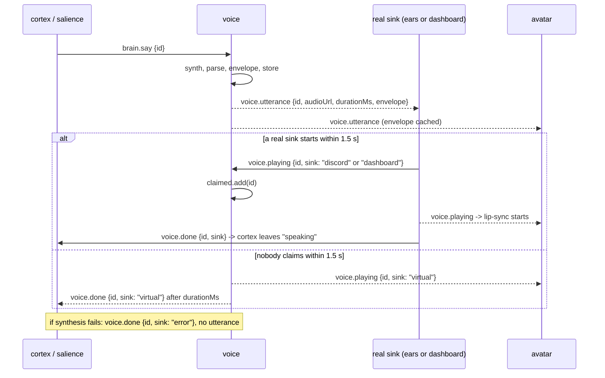

# voice

> Brownfield LLD, mapped 2026-10-31 at git `686cc8f`. Describes what the code does today. A rationale cell cites the code comment, commit or design note that states the reason; cells still marked `[inferred]` have no such source and wait for the project owner. HLD: [high-level-design](../../high-level-design.md).

## Context and Design Philosophy

voice turns the brain's `brain.say` into audio and is the **owner of the audio-sink arbitration protocol** that decides who plays that audio and when the brain may move on. It is one Node process (`services/voice`) with three jobs, as its header comment lays out (`services/voice/src/index.ts:1-9`):

1. **Synthesize.** Call a TTS server (Kokoro-FastAPI, OpenAI-compatible) or, with `voice.engine: stub`, fabricate a silent WAV of plausible length.
2. **Describe and serve.** Parse the WAV, compute a 30 Hz mouth-open envelope for lip-sync, keep the WAV in a bounded in-memory store, publish `voice.utterance`, and serve the bytes over HTTP on `:8700` so any sink can fetch them.
3. **Arbitrate sinks.** Voice does not play audio itself. Sinks ([ears](../ears/ears-design.md) as `discord`, [dashboard](../dashboard/dashboard-design.md) as `dashboard`) claim an utterance by publishing `voice.playing`; if nobody does within 1.5 s voice pretends to be a sink (`virtual`) so the brain never waits forever; if synthesis fails voice releases the brain with a `voice.done` from sink `error`.

Design leanings visible in the code:

- **Keep the brain moving.** Every failure path ends in a `voice.done` (error sink, virtual sink) so [cortex](../cortex/cortex-design.md) is never left in `speaking` (`voice.ts:112-116`, `voice.ts:106-111`). The comments say so directly: "a virtual sink times it so the brain moves on" (`index.ts:7-8`) and "Let the brain continue even though nothing was said" (`voice.ts:114`).
- **Binary audio never rides the bus.** The bus carries a URL, a duration, and a small envelope; the WAV is fetched over HTTP (`packages/bus/src/events.ts:126-137`). `[inferred]`
- **Effects injected, logic testable.** `Voice` takes `bus`, `log`, `synth`, `publicUrl` (`voice.ts:8-15`); synthesizers are plain functions; tests drive `Voice.onEvent` and `Voice.handle` directly with a `FakeBus` and mocked timers. `[inferred]`
- **A stub engine is a first-class mode** so the whole bus path can run with no TTS container (commit `51d5a9c`, "mock/off backends so any service runs on Redis alone").

Ownership notes (from the mapping brief): `src/health.ts` implements the heartbeat contract owned by [control-plane](../control-plane/control-plane-design.md); the voice `stub` backend belongs here; the `voice.*` event schemas live in [event-bus](../event-bus/event-bus-design.md).

## Synthesis Pipeline

Boot (`index.ts:16-32`): load config, create `Bus("voice")`, build `VoiceHealth(cfg.voice.engine)`, start the heartbeat, read `VOICE_PORT` (default `8700`) and `PUBLIC = urls.voice()`, pick the synthesizer, create `Voice`, listen on the port (then `heartbeat.ready()`), and start one bus loop:

`bus.subscribe({ group: "voice", types: ["brain.say", "voice.playing"], fromNow: true }, ev => voice.onEvent(ev))` (`index.ts:30`).

That single loop handles events strictly one at a time (`packages/bus/src/index.ts:151-159` awaits the handler per entry). While a `brain.say` is being synthesized, a following `voice.playing` claim waits behind it.

`fromNow` only positions the group when `subscribe` creates it (`XGROUP CREATE ... $`, `packages/bus/src/index.ts:126-131`). When the `voice` group already exists, voice resumes after the group's last-delivered entry, so `brain.say` lines published while voice was down are spoken when it comes back. Skipping that backlog depends on whoever starts voice resetting the group first: the control plane's `fresh` start mode does (voice's manifest default, `packages/control/src/manifest.ts:44`; reset at `packages/control/src/controller.ts:42` via `Bus.resetGroup`, `packages/bus/src/index.ts:109-120`); a compose `restart: unless-stopped` restart (`docker-compose.yml:9`) does not.

The subscribe call is `void`-ed with no `.catch` (`index.ts:30`). A Redis outage does not reject it (the subscriber connection uses `maxRetriesPerRequest: null`, so its commands wait for the reconnect, `packages/bus/src/index.ts:124`), but any other Redis error escapes the loop as an unhandled rejection, which ends the process on Node 22.

`onSay` (`voice.ts:88-117`), per `brain.say { id, text, emotion, gesture, ... }`:

1. `wav = await synth(text)`.
2. `info = parseWav(wav)`; `env = envelope(wav, info, 30)`.
3. `put(id, wav)` into the store, **before** announcing it.
4. Publish `voice.utterance { id, text, emotion, gesture, durationMs: round(info.durationMs), envelopeHz: 30, envelope, audioUrl: <PUBLIC>/audio/<id>.wav, sampleRate }`.
5. Arm the 1.5 s virtual-sink timer (see Sink Arbitration).
6. Any exception in 1-5 is caught: log `"tts failed"`, publish `voice.done { id, sink: "error" }` (`voice.ts:112-116`). That covers TTS HTTP errors, a non-WAV reply, a non-16-bit WAV (envelope throws), and a failed publish. No `voice.utterance` is emitted in that case (unless the failure was the timer-arming step, which cannot throw).

The timer callbacks run outside that `try`. Their publishes (`voice.ts:109-110`) have no `.catch`; the publishing connection gives up after three reconnect attempts (`maxRetriesPerRequest: 3`, `packages/bus/src/index.ts:43`), so a virtual-sink timer that fires during a Redis outage leaves an unhandled rejection and Node 22 ends the process.

Voice speaks **everything** on `brain.say` regardless of `injected` / `remember` flags, `control` mute, or `reason`; those are handled upstream.

### Engines

| `voice.engine` | Synthesizer | Network | Heartbeat |
| --- | --- | --- | --- |
| `kokoro` (default) | `kokoroSynth`: `POST <TTS_URL>/v1/audio/speech` with JSON `{ model: "kokoro", input: text, voice: cfg.voice, speed: cfg.speed, response_format: "wav" }`; non-2xx throws `tts <status>: <body>` (`voice.ts:18-34`) | yes (`urls.tts()`, default `http://127.0.0.1:8880`) | mode `live`, `deps.kokoro` follows the last synthesis (`health.ts:7-19`) |
| `stub` | `stubSynth`: zero-filled mono PCM16 WAV at `voice.sample_rate`, duration `max(400, 60 * text.length)` ms (`voice.ts:36-62`) | none | mode `mock`, `deps.kokoro: n/a`; startup logs a warning (`index.ts:23`) |

`voice.engine` comes from `VOICE_ENGINE` via `config/config.example.yaml:128` (an empty value falls back to `kokoro`, `packages/config/src/schema.ts:155`); `voice.voice` (default `af_heart`), `voice.speed` (schema default 1, example YAML 1.05), `voice.sample_rate` (24000, **used only by the stub**; Kokoro's rate comes from the WAV it returns) are in `packages/config/src/schema.ts:153-158`. The stub's shape follows the isolated-backends design: a silent PCM16 mono WAV sized from the text "so `parseWav`/`envelope` and `voice.utterance` fields stay real" (`openspec/changes/archive/2026-11-01-add-isolated-backends/design.md`, D5).

### WAV parsing and the lip-sync envelope

`parseWav` (`wav.ts:12-34`): requires `RIFF`...`WAVE`; walks chunks (odd sizes padded), reads channels / sample rate / bits from `fmt `, and on `data` clamps the length to the buffer (tolerates truncated or streamed replies) and computes `durationMs = frames / sampleRate * 1000`. Throws `not a RIFF/WAVE file` or `no data chunk`. It does not check the format tag (PCM vs float) and a missing `fmt ` leaves zeros (divide by zero).

`envelope` (`wav.ts:40-59`): 16-bit only (throws `unsupported bit depth N`); reads **only the first channel**; one window per `floor(sampleRate / hz)` frames (800 at 24 kHz / 30 Hz) including a partial last window; per window `min(1, (rms / 0.22) ^ 0.8)`; then a one-pole release `out[i] = max(out[i], out[i-1] * 0.6)` so the mouth closes over several windows; rounded to 2 decimals. `ENVELOPE_HZ = 30` is a constant (`voice.ts:6`). [avatar](../avatar/avatar-design.md) consumes the envelope from `voice.utterance` and indexes it from `voice.playing`.

## Audio Store and HTTP

The store (`voice.ts:66-78`) is a `Map<id, Buffer>` plus an insertion-order array; `put` evicts from the front while more than 50 ids are held. Eviction is by count only, not size or age, and the same id published twice is stored twice in `order` (the second `put` overwrites the buffer but both order entries later delete the one key).

`Voice.handle` (`voice.ts:119-131`), mounted on a plain `http.createServer` listening on all interfaces:

| Request | Response |
| --- | --- |
| `GET /audio/<id>.wav` where `id` matches `[\w-]+` and is stored | `200`, `content-type: audio/wav`, `content-length`, `access-control-allow-origin: *`, WAV body |
| same path, id unknown or evicted | `404` body `gone` |
| `GET /health` | `200` body `ok` (no check of Redis or TTS) |
| anything else | `404`, empty body |

Method is not checked (any method on those paths behaves like GET), and the match is on the raw request URL, so a query string turns a valid path into a 404. `/health` is a liveness ping only: container health comes from heartbeat freshness, and voice keeps `/health` alongside it (`openspec/changes/archive/2026-11-01-add-service-health/design.md`, D5). `urls.voice()` (`packages/config/src/index.ts:163`) is the base used in `audioUrl`: `VOICE_URL`, else `http://127.0.0.1:<VOICE_PORT>`, a loopback default chosen so host runs work outside Docker (commit `e53badc`, "default VOICE_URL to loopback outside Docker"); compose sets `VOICE_URL=http://voice:8700` for every TS service (`docker-compose.yml:18`). Compose does **not publish** port 8700 to the host (`docker-compose.yml:129-134`); in-network sinks (ears) fetch directly and browsers reach audio through the dashboard's `/audio/*` proxy (`services/dashboard/src/routes.ts:55-60`).

## Sink Arbitration Protocol

Voice owns this protocol; [ears](../ears/ears-design.md) and [dashboard](../dashboard/dashboard-design.md) are sinks that follow it, [cortex](../cortex/cortex-design.md) and [avatar](../avatar/avatar-design.md) consume its outcome. It is entirely carried by three events in `packages/bus/src/events.ts`:

| Event | Payload | Meaning |
| --- | --- | --- |
| `voice.utterance` | `{ id, text, emotion, gesture?, durationMs, envelopeHz, envelope, audioUrl, sampleRate }` | Audio for `id` exists at `audioUrl`; any sink may fetch and play it (`events.ts:126-137`) |
| `voice.playing` | `{ id, sink: string }` | The named sink started playing `id` (`events.ts:140`) |
| `voice.done` | `{ id, sink: string }` | The named sink finished (or gave up on) `id` (`events.ts:141`) |

`sink` is a free-form string. Values in use: `"discord"` (ears), `"dashboard"` (dashboard browser page), `"virtual"` (voice's fallback), `"error"` (voice, synthesis failed).

### Sequence

### Rules (as implemented)

1. **Claiming.** On every `voice.playing` that voice reads, if `sink !== "virtual"` the id is added to the `claimed` set (`voice.ts:82-85`). The virtual sink's own `voice.playing` therefore claims nothing. That exclusion has no observable effect unless an id is re-used, because voice publishes its virtual `voice.playing` only after the claim check has already passed. Claims are never removed.
2. **Virtual fallback.** Right after publishing `voice.utterance`, voice arms `setTimeout(1500)`. When it fires and the id is not in `claimed`, voice publishes `voice.playing { id, sink: "virtual" }` and arms `setTimeout(info.durationMs)` to publish `voice.done { id, sink: "virtual" }` (`voice.ts:106-111`). If the id is claimed, voice does nothing further for it. The claim set is consulted once, when the 1.5 s timer fires: a claim that arrives after the virtual `voice.playing` does not cancel the pending virtual `voice.done`.
3. **Error release.** On any synthesis-path failure voice publishes only `voice.done { id, sink: "error" }` (`voice.ts:115`). No virtual timers run.
4. **Sinks' duties.** A sink should publish `voice.playing` when audio actually starts and `voice.done` when it ends. Dashboard: on the `<audio>` element's `play` / `ended` / `error`, via `POST /sink` which the dashboard turns into `voice.playing` / `voice.done` with `sink: "dashboard"` (`services/dashboard/public/index.html:141-143`, `services/dashboard/src/routes.ts:110-114`). ears: `Playback` as described in the [ears LLD](../ears/ears-design.md). Both receive `voice.utterance` over the bus (dashboard through its tail).
5. **Who is released by `voice.done`.** cortex clears `speakingId` on the first `voice.done` for its own id from **any** sink (`services/cortex/src/cortex.ts:53-57`), with `brain.cortex.speaking_timeout_ms` (20 s) as a backstop (`cortex.ts:143`, `packages/config/src/schema.ts:147-148`). avatar starts lip-sync on `voice.playing` and ends it on `voice.done` for the matching id (`services/avatar/src/index.ts:50-51`).
6. **Voice never reads `voice.done`.** It does not subscribe to it and keeps no per-id lifecycle; completion tracking is entirely the consumers'.

### Known limits of the protocol (observed, not designed)

- **Slow or queued real sinks look like absent sinks.** The claim window is a fixed 1.5 s measured from `voice.utterance`, but a sink may legitimately start later: ears queues utterances behind the one playing and then does a fetch, convert and play before publishing `voice.playing` (`services/ears/src/playback.ts:38-45`); a second line queued behind a long first line is always timed by the virtual sink. A real sink that arrives after the virtual one produces a **second** `voice.playing` and a **second** `voice.done` for the same id, and the audio may play after cortex already considers the line finished. For [avatar](../avatar/avatar-design.md), the late `voice.playing` restarts lip-sync from the first envelope value and the virtual `voice.done`, still pending, can close the mouth while the real sink is playing (`services/avatar/src/engine.ts:39-49`). (VOICE-SINK-008)
- **No exclusivity.** If both ears and a dashboard sink are active they both claim, both play, and both publish; voice only uses claims to suppress its own fallback, never to pick one sink.
- **Claim ordering.** Claims are read by the same sequential loop that runs TTS. A claim for utterance A can be queued behind the synthesis of utterance B, so the 1.5 s timer for A may fire before the claim is processed and produce a spurious virtual pair. `[inferred]` (loop semantics at `packages/bus/src/index.ts:151-159`; timer at `voice.ts:107`.)
- **Unbounded `claimed`.** Entries are never pruned, unlike the audio store's 50-item bound (`voice.ts:70,84`). (VOICE-SINK-007)
- **Timers outlive shutdown.** The virtual timers are not tracked or cleared; shutdown closes the server and stops the bus (`index.ts:32`).
- **Timer publishes are unguarded.** A virtual `voice.playing` / `voice.done` publish that fails (for example during a Redis outage) is an unhandled rejection that ends the process (`voice.ts:107-110`); see Synthesis Pipeline.
- **A silent dashboard sink is still "a sink".** The dashboard page queues every `voice.utterance` even while audio is disabled and only plays when enabled (`index.html:135-137,321`); because it publishes `voice.playing` only on actual playback, a disabled page falls through to the virtual sink correctly, but a later enable replays the stale backlog.

## Health

`VoiceHealth` (`health.ts:7-19`): `service: "voice"`; `kokoro` engine gives mode `live` and `deps.kokoro` `ok` initially, `down` after any failed synthesis, `ok` again after the next success (the synthesizer is wrapped with `tracked`, `index.ts:24`); `stub` gives mode `mock` and `kokoro: "n/a"`. `heartbeat.ready()` is called when the HTTP server starts listening (`index.ts:28`), not when the bus subscription is up. `startHeartbeat` (owned by [control-plane](../control-plane/control-plane-design.md)) reports `degraded` while a dep is `down`. Shutdown closes the HTTP server and stops the bus after the pre-shutdown `stopping` heartbeat (`index.ts:32`, `packages/bus/src/index.ts:230-246`).

## Decisions & Alternatives

| Decision | Chosen | Alternatives Considered | Rationale |
| --- | --- | --- | --- |
| Where audio plays | Voice synthesizes and serves; separate sinks play | Voice plays locally; push audio over the bus | Header comment: voice keeps the WAV and serves it "so any 'sink' (dashboard audio page captured by OBS, the Discord bot) can fetch and play it" (`index.ts:4-7`). |
| How audio reaches sinks | HTTP GET of a stored WAV by URL | Base64 on the stream | `[inferred]` events carry only `audioUrl`; schema comment "Path on the voice service" (`events.ts:134`). |
| Brain release when nobody plays | Virtual sink timed by `durationMs` after 1.5 s | Wait for a sink indefinitely; timeout in cortex only | Header comment: "if no sink picks an utterance up, a virtual sink times it so the brain moves on" (`index.ts:7-8`). The 1.5 s figure itself is `[inferred]`; cortex also has its own 20 s backstop. |
| Claim mechanism | Any non-`virtual` `voice.playing` for the id suppresses the fallback | Explicit sink registration; sink ack protocol | `[inferred]` smallest change on the existing events (`voice.ts:84`). |
| TTS failure | Publish `voice.done` sink `error`, no utterance | Retry; emit a silent utterance | Comment: "Let the brain continue even though nothing was said" (`voice.ts:114`). |
| Audio store | In-memory map, newest 50 | Disk, TTL | `[inferred]` sinks fetch immediately; bounded memory (`voice.ts:77`). |
| Envelope shape | 30 Hz RMS, soft knee `(rms/0.22)^0.8`, 0.6 release | Peak, FFT/visemes | Comments: the soft knee makes "normal speech read as ~0.3-0.8 mouth-open rather than hugging zero" and the release is "light smoothing so the mouth doesn't flicker" (`wav.ts:36-38,56`). Peak and FFT/visemes are `[inferred]` alternatives. |
| Envelope source channel | First channel only | Mix channels | `[inferred]` Kokoro returns mono (`wav.ts:1`, `wav.test.ts:81`). |
| WAV support | 16-bit PCM only | Floats / other depths | Comment: "PCM 16-bit only (what Kokoro emits)" (`wav.ts:1`). |
| Stub engine | Silent WAV sized 60 ms/char (min 400 ms) | Skip voice.utterance entirely | Isolated-backends design D5: silence sized from the text "so `parseWav`/`envelope` and `voice.utterance` fields stay real" (`openspec/changes/archive/2026-11-01-add-isolated-backends/design.md`; commit `51d5a9c`). |
| `audioUrl` base default | `VOICE_URL`, else loopback `http://127.0.0.1:<VOICE_PORT>` | `http://voice:<VOICE_PORT>` | Commit `e53badc`: "default VOICE_URL to loopback outside Docker"; compose already sets `VOICE_URL=http://voice:8700`. |
| Subscription | One sequential loop; group created at the newest entry; backlog skipping on restart left to the control plane's `fresh` start | Resume backlog; reset the group inside voice | `[inferred]` stale `brain.say` lines should not be spoken after a restart (`index.ts:30`; manifest default start mode `fresh` for voice, `packages/control/src/manifest.ts:44`). |
| Serving | Plain `node:http`, CORS `*` | Express | `[inferred]` dependency-free; CORS lets browser sinks fetch cross-origin (`voice.ts:125`). |

## Open Questions & Future Decisions

1. **Duplicate `voice.playing` / `voice.done` with a slow real sink.** If a real sink starts after 1.5 s, both it and the virtual sink report, and a claim that lands after the virtual `voice.playing` does not cancel the pending virtual `voice.done` (`voice.ts:107-110`). Whether voice should suppress, extend its window to account for sink queues, cancel the virtual `voice.done` on a late claim, or have sinks stop on `virtual` is undecided (ears queue at `services/ears/src/playback.ts:38-45`). VOICE-SINK-004 states what the code does: a claim counts only if it is in by the end of the 1.5 s window. A stricter rule, "while an id is claimed, publish no virtual `voice.playing` or `voice.done`", would also make a late claim cancel the virtual `voice.done`; which of the two is intended is not recorded. VOICE-SINK-008 is worded for the whole protocol ("the arbitration protocol shall"), so satisfying it may need changes in the sinks, not only in voice. (VOICE-SINK-004, VOICE-SINK-008)
2. **`claimed` is never pruned** (`voice.ts:70,84`), unlike the store. (VOICE-SINK-007)
3. **Single sequential loop does TTS and claim intake.** A slow synthesis delays claim processing and can cause spurious virtual pairs; synthesis could be moved off the loop (as cortex does with `void this.think(...)`, `cortex.ts:61`). `[inferred]`
4. **No exclusivity or sink priority.** Nothing prevents two sinks playing the same line (both Discord and the dashboard page open). Is that wanted?
5. **Compose does not publish :8700** (`docker-compose.yml:129-134`). In-network sinks (ears) fetch from `http://voice:8700` and browsers go through the dashboard's `/audio/*` proxy; a sink running on the host cannot reach a composed voice. Whether host-side sinks are a supported topology is unstated. The frozen OpenSpec baseline still gives `http://voice:<VOICE_PORT>` as the `VOICE_URL` default; the loopback default in code is deliberate (commit `e53badc`).
6. **Two near-duplicate WAV parsers.** `services/voice/src/wav.ts:12-34` (`parseWav`: validates RIFF/WAVE, returns bits and duration) and `services/ears/src/audio.ts:41-52` (`readWavHeader`: no RIFF check, no bit depth, throws `bad wav`), plus `services/ears/src/inject.ts:34-43` adding a RIFF check around it, plus two WAV writers (`stubSynth` header at `voice.ts:41-62`, ears `wavWrap` at `audio.ts:54-61`). No shared package. Consolidation target is undecided.
7. **Cross-service test import.** `services/voice/test/voice.test.ts:5` imports `../../ears/src/audio.js` (only for `wavWrap`), coupling voice's test run to ears' source; `services/voice/tsconfig.json` has `include: ["src"]`, so tests are not type-checked by `tsc -b` and only run through tsx (root `package.json:19`).
8. **`parseWav` robustness.** No check of the `fmt ` format tag or that `fmt ` precedes `data`; a missing `fmt ` chunk (zero bits or channels) yields a non-finite duration (`wav.ts:17-29`). Envelope silently ignores extra channels.
9. **HTTP method and query strings.** `Voice.handle` does not check the method, and it matches the raw URL, so `/audio/<id>.wav?x` or `/health?x` returns 404 (`voice.ts:121,129`).
10. **Id reuse.** Re-synthesizing an existing id appends a second entry to `order` (`voice.ts:75-77`), so one eviction can remove an id that is still the newest.
11. **Config defaults diverge.** `voice.speed` schema default is 1 (`schema.ts:157`) but `config/config.example.yaml:130` ships 1.05; the frozen OpenSpec says default 1.
12. **Heartbeat `ready` precedes the bus subscription** (`index.ts:28,30`), so a service can report ready a moment before it can receive `brain.say`.
13. **No tests for `index.ts`** (boot wiring, the stub warning, the port, signal handling and shutdown) or for the interplay of a real sink arriving after the virtual one. VOICE-SYN-001, VOICE-STUB-003 and VOICE-HTTP-005 have no test; VOICE-HLTH-001 and VOICE-HLTH-004 are tested only through the heartbeat spec.
14. **Restart replays the `brain.say` backlog unless the group is reset.** VOICE-SYN-001 positions only a newly created group at the newest entry (`packages/bus/src/index.ts:126-131`); an existing group resumes where it stopped. A compose restart therefore speaks every line published while voice was down; only a control-plane `fresh` start skips them (`packages/control/src/manifest.ts:44`). If "stale lines are never spoken after a restart" is the intended rule, voice (or the bus) has to enforce it. `[inferred]`
15. **VOICE-SINK-005 is not observable.** The virtual `voice.playing` is published only after its claim check (`voice.ts:107-109`), so excluding it from `claimed` changes nothing unless an id is re-used. The test that looks like it covers this sends a virtual echo for an id that was never said (`voice.test.ts:55`).
16. **Store-before-publish has no test.** VOICE-SYN-004 (the WAV is in the store before `voice.utterance` goes out, so a sink fetching at once never gets `gone`) is held only by statement order (`voice.ts:96-98`).
17. **Unhandled rejections.** The virtual-sink timer publishes (`voice.ts:107-110`) and the subscription (`index.ts:30`) have no `.catch`, and no `unhandledRejection` handler exists in `packages/` or `services/`. On Node 22 (`Dockerfile`: `node:22-slim`) an unhandled rejection ends the process; compose then restarts it (`docker-compose.yml:9`). No spec says what voice should do on these failures; avatar has a gap line for its own subscription (AVATAR-BUS-008).

## References

Files in this segment:

- `services/voice/src/index.ts`, `voice.ts`, `wav.ts`, `health.ts`
- `services/voice/test/health.test.ts`, `stub.test.ts`, `voice.test.ts`, `wav.test.ts`
- `services/voice/package.json`, `services/voice/tsconfig.json`

Other segments (arrow shows direction):

- voice -> [event-bus](../event-bus/event-bus-design.md): consumes `brain.say`, `voice.playing` (group `voice`, created at the newest entry); publishes `voice.utterance`, `voice.playing` (virtual), `voice.done` (virtual / error), heartbeats.
- voice -> [config](../config/config-design.md): `loadConfig` (`voice.*`), `urls.tts()`, `urls.voice()`, `envOr("VOICE_PORT")`.
- voice <- [cortex](../cortex/cortex-design.md) and [salience](../salience/salience-design.md): publish `brain.say`; cortex consumes `voice.done`.
- voice <-> [ears](../ears/ears-design.md): ears is the `discord` sink and fetches `audioUrl`.
- voice <-> [dashboard](../dashboard/dashboard-design.md): dashboard is the `dashboard` sink and proxies `GET /audio/*` to voice.
- voice -> [avatar](../avatar/avatar-design.md): `voice.utterance` envelope + `voice.playing` / `voice.done` drive lip-sync.
- voice -> [control-plane](../control-plane/control-plane-design.md): heartbeat contract; manifest entry sets `VOICE_ENGINE=stub` for isolated starts (`packages/control/src/manifest.ts:44`).
- voice -> [deployment](../deployment/deployment-design.md): compose service `voice` depends on `tts` and does not publish its port.

External: Kokoro-FastAPI (OpenAI-compatible `POST /v1/audio/speech`), Node `http`.

OpenSpec: `openspec/specs/voice/spec.md`; deltas `openspec/changes/archive/2026-11-01-add-service-health/specs/voice/spec.md`, `openspec/changes/archive/2026-11-01-add-isolated-backends/specs/voice/spec.md`.

EARS specs: [voice-specs.md](./voice-specs.md).
